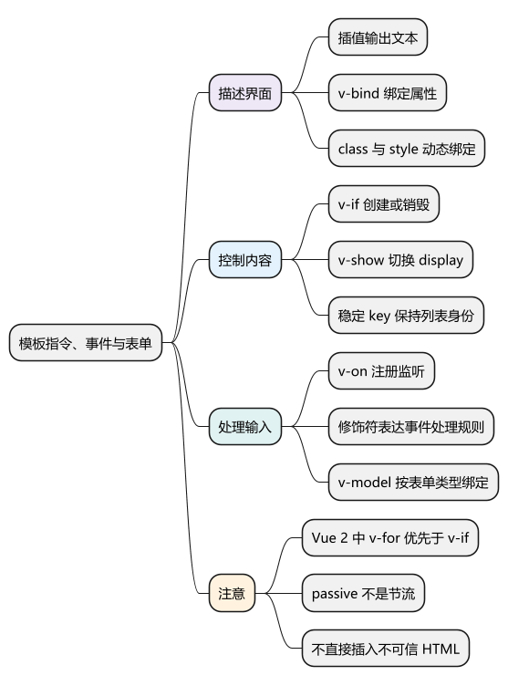
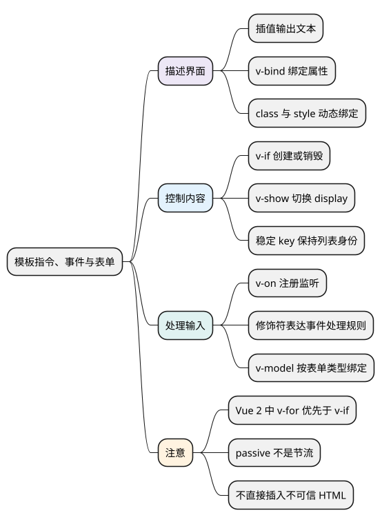

# 模板指令、事件与表单

<!-- core-mindmap:start -->
[](examples/v2b02-mindmap.svg)

<details>
<summary>PlantUML 源码</summary>



</details>

<!-- core-mindmap:end -->

**口述总览：** 模板负责把状态显示为界面，指令负责绑定属性、条件、列表和事件。表单输入通过事件更新状态，状态再决定界面显示；理解这条流程，比只记指令名字更容易定位问题。

本文使用 Vue 2.7.16 Options API，示例也适用于 Vue 2.6。

## 插值与 v-bind：显示文本和绑定属性

`{{ message }}` 显示文本；`v-text` 更新整个元素的文本内容；`v-bind:title="message"` 简写为 `:title="message"`，绑定的是属性表达式。

`class` 支持对象和数组，例如 `:class="{ active: selected }"`；`style` 支持样式对象和数组，例如 `:style="{ color: color }"`。样式对象中的 `fontSize` 等属性可以使用驼峰写法。

下面的单文件组件把列表、条件、样式、事件和表单串在一起，可放进已有 Vue 2 项目的 `App.vue`。

<!-- example: v2b02-template-form -->
```vue
<template>
  <section :class="{ compact: compact }" :style="{ color: color }">
    <form @submit.prevent="addTask">
      <input v-model.trim="title" aria-label="任务名称">
      <input v-model.number="priority" type="number" min="1" max="3"
        aria-label="优先级">
      <button type="submit">添加</button>
    </form>
    <label><input v-model="compact" type="checkbox">紧凑显示</label>
    <select v-model="color" aria-label="文字颜色">
      <option value="#222">黑色</option>
      <option value="#0066aa">蓝色</option>
    </select>
    <p v-if="tasks.length === 0">还没有任务</p>
    <ul v-else>
      <li v-for="task in tasks" :key="task.id">
        {{ task.title }}（优先级 {{ task.priority }}）
        <button @click="removeTask(task.id)">删除</button>
      </li>
    </ul>
    <p v-show="compact">当前为紧凑模式</p>
  </section>
</template>

<script>
export default {
  data() {
    return {
      title: '', priority: 1, compact: false,
      color: '#222', tasks: [], nextId: 1
    }
  },
  methods: {
    addTask() {
      const validPriority = Number.isInteger(this.priority)
        && this.priority >= 1 && this.priority <= 3
      if (!this.title || !validPriority) return
      this.tasks.push({
        id: this.nextId++, title: this.title, priority: this.priority
      })
      this.title = ''
    },
    removeTask(id) {
      this.tasks = this.tasks.filter(task => task.id !== id)
    }
  }
}
</script>

<style scoped>
li { padding: 12px 0; }
.compact li { padding: 4px 0; }
</style>
```

这个例子使用递增 ID 标识任务；删除后剩余任务的 ID 不变，Vue 可以继续把相应节点与同一项任务对应起来。

## v-if、v-show 与 v-for：控制创建、显示和身份

- `v-if`：条件为假时不创建对应内容；切换会销毁或重建组件，适合不常出现且创建成本较高的区域。
- `v-show`：内容会创建，用 CSS `display` 控制显示，适合经常切换但能接受初始创建成本的内容。
- `v-for`：遍历数组或对象。数组可写 `(item, index) in items`，对象可写 `(value, key, index) in object`。
- `key`：帮助 Vue 判断节点身份，应使用同级唯一且稳定的字符串或数字；有插入、删除、排序或局部状态时，不宜使用数组索引。

**Vue 2 中，同一节点的 `v-for` 优先于 `v-if`。** 条件会在每次循环中判断，并非先把所有真实 DOM 创建出来再隐藏。实际代码应先通过计算属性筛选列表，或在外层使用 `v-if` 控制整块列表，避免混写带来的理解成本。

`v-show` 不支持 `<template>`，也不能与 `v-else` 配对。不要把 `v-if` 总结成“总是比 `v-show` 慢”，两者主要是初始成本和切换成本的取舍。

## v-on 与修饰符：处理交互并说明意图

`v-on:click="save"` 简写为 `@click="save"`。没有显式参数时，方法会收到事件对象；需要同时传业务参数和事件时，可以写 `@click="save(item, $event)"`。

- `.prevent` 阻止默认行为；`.stop` 阻止事件继续传播，两者解决的问题不同。
- `.self` 仅在 `event.target === event.currentTarget` 时调用处理函数，并不阻止冒泡。
- `.capture` 使用捕获监听；`.once` 让监听器只触发一次；`.enter` 等键修饰符筛选按键。
- `.passive` 表示监听器不会阻止默认行为，不是节流；不要和 `.prevent` 同时使用。
- Vue 2 的组件 `.native` 监听组件根元素的原生事件，不是“保证自定义事件能执行”的开关；根元素变化会影响它的含义。

修饰符顺序会影响生成代码，例如 `.prevent.self` 可能先阻止来自子元素的默认行为，而 `.self.prevent` 会先检查事件来源。

## v-model：绑定表单值与更新事件

原生文本输入主要使用 `value` 与 `input`，复选框、单选框主要使用 `checked` 与 `change`，下拉框使用 `value` 与 `change`。因此不能把所有 `v-model` 都机械地展开成 `value + input`。

- `.trim` 去除输入值首尾空白，不移除文字中间的空格。
- `.number` 尝试通过数字解析转换；无法解析时保留原值，清空输入也不保证得到数字，因此仍需要业务校验。
- `.lazy` 将文本同步从 `input` 改为 `change`；通常在提交输入变化时触发，不能简单等同于每次失焦。

`v-model` 以 JavaScript 状态为数据来源，不依赖 HTML 上预写的 `value` 或 `checked` 决定初始状态。组件上的模型规则见[组件通信、插槽与 v-model](04_组件通信、插槽与v-model.md)。

## 注意：HTML 输出与一次性渲染

`v-html` 把内容作为 HTML 插入，不会把其中的字符串继续编译成 Vue 模板；不要直接渲染未经可信处理的外部 HTML。普通文本优先用插值。

`v-once` 跳过该内容后续更新；`v-pre` 跳过模板编译；`v-cloak` 配合 CSS 隐藏直接在页面编译时尚未完成的插值。这几个指令目的不同，不是通用性能开关。

<a id="interview"></a>

## 试题

<a id="v2b02-01"></a>

### V2B02-01 [P0·基础] v-if 和 v-show 怎么选择？

先看是否需要保留已创建的内容和组件状态，再看切换频率。`v-if` 切换会销毁或重建，初始条件为假时可以省掉创建成本；`v-show` 保留内容，通过 `display` 切换，经常显示隐藏时通常更合适。

<a id="v2b02-02"></a>

### V2B02-02 [P0·基础] Vue 2 中 v-for 与 v-if 谁先处理，为什么不推荐放在同一节点？

Vue 2 先处理 `v-for`，所以每次循环都需要判断条件。可以用计算属性先筛选，或把控制整块列表的条件放到外层。它不是语法禁止，也不是先创建全部 DOM 再删除；Vue 3 的同节点优先级与此不同。

<a id="v2b02-03"></a>

### V2B02-03 [P0·基础] v-model 是不是任何场景都等于 value 加 input？

不是。原生文本输入主要如此，复选框和单选框使用 `checked` 与 `change`，下拉框使用 `value` 与 `change`。Vue 2 自定义组件默认使用 `value` prop 和 `input` 事件，还能通过 `model` 选项调整。

<a id="v2b02-04"></a>

### V2B02-04 [P1·理解] key 是否只是为了让列表渲染更快？

首先是保证节点身份与业务数据正确对应，让带有输入状态或组件状态的节点被正确复用。稳定 ID 可以在重排后保持身份；索引在重排时会对应不同数据，随机 key 则可能不断重建。性能是合理复用带来的结果，不能保证加 key 就一定更快。

参考：[Vue 2 模板](https://v2.vuejs.org/v2/guide/syntax.html)、[列表渲染](https://v2.vuejs.org/v2/guide/list.html)、[事件处理](https://v2.vuejs.org/v2/guide/events.html)、[表单绑定](https://v2.vuejs.org/v2/guide/forms.html)。
