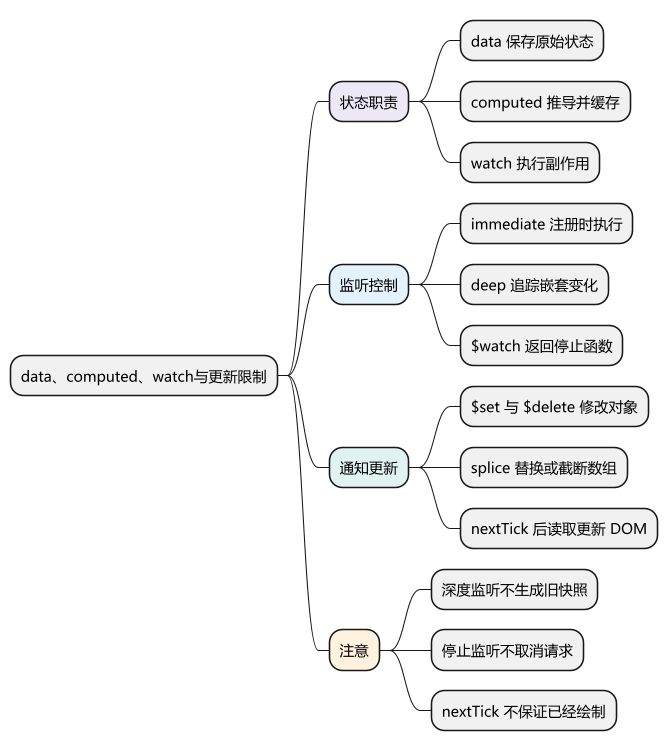
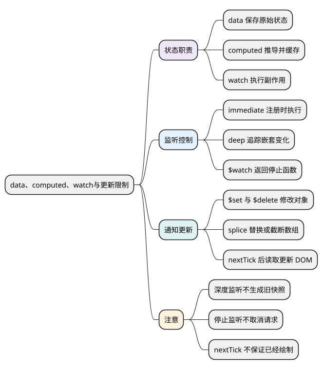
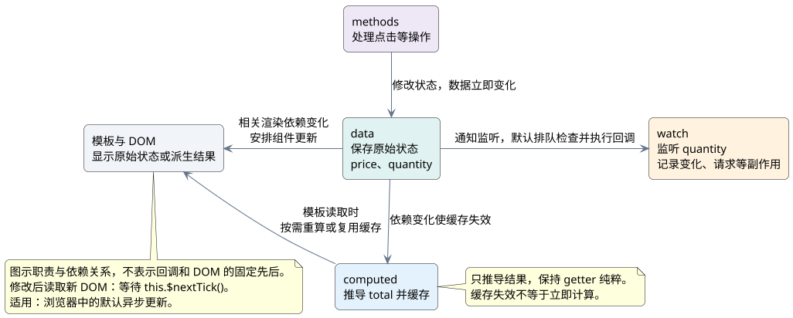

# data、computed、watch与更新限制

<!-- core-mindmap:start -->
[](examples/v2b03-mindmap.svg)

<details>
<summary>PlantUML 源码</summary>



</details>

<!-- core-mindmap:end -->

**口述总览：** `data` 保存原始状态，`computed` 根据现有状态推导结果，`watch` 在数据变化后执行操作。Vue 2 对已声明的普通对象属性建立 getter、setter，对数组的部分修改方法做了处理，因此新增或删除属性、直接按数组索引赋值时，需要注意通知更新的方式。

本文以 Vue 2.7.16 Options API 验证，下面的用法也适用于 Vue 2.6。

## computed：推导结果并复用缓存

计算属性适合金额、筛选列表、展示文本等派生值。它在读取时计算并缓存结果；依赖变化后使缓存失效，再次读取时重新计算，不是每次页面渲染都重新执行。

下面示例中，`total` 是派生值，`watch` 记录数量变化，按钮则演示如何等待 DOM 更新。

<!-- example: v2b03-derived-state -->
```vue
<template>
  <section>
    <p ref="summary">合计：{{ total }}</p>
    <button @click="increase">数量加一</button>
    <p>{{ changeMessage }}</p>
    <p>更新后的 DOM：{{ domText }}</p>
  </section>
</template>

<script>
export default {
  data() {
    return { price: 20, quantity: 1, changeMessage: '', domText: '' }
  },
  computed: {
    total() {
      return this.price * this.quantity
    }
  },
  watch: {
    quantity: {
      immediate: true,
      handler(value, oldValue) {
        this.changeMessage = oldValue === undefined
          ? `初始数量：${value}`
          : `数量从 ${oldValue} 改为 ${value}`
      }
    }
  },
  methods: {
    async increase() {
      this.quantity += 1
      await this.$nextTick()
      this.domText = this.$refs.summary.textContent
    }
  }
}
</script>
```

计算属性 getter 应保持纯粹，避免修改其他状态、发送请求或操作 DOM。如果要响应用户赋值，可以使用 `{ get, set }` 形式，把赋值映射回原始状态；setter 不是用来直接修改缓存的。

方法每次被调用都会执行，更适合需要参数的操作。不要记成“computed 一定比 methods 好”，二者职责不同。

<!-- understanding-flow: v2b03-state-roles:start -->
<a id="v2b03-state-roles"></a>

沿下面的关系区分“保存什么、推导什么、变化后做什么”，不必把同一个结果同时维护在 `data`、`computed` 和 `watch` 中。

<details>
<summary>PlantUML 源码</summary>



</details>

<!-- understanding-flow: v2b03-state-roles:end -->

## watch：执行副作用并控制监听范围

`watch` 适合保存草稿、触发请求、记录变化等操作。它可以监听简单路径，也可以通过 `this.$watch(() => this.form.name, callback)` 监听 getter。

- `immediate: true`：注册后立即调用一次，初次旧值是 `undefined`。Options API 的这次调用早于 `created`，不要访问此时尚不存在的 DOM。
- `deep: true`：遍历嵌套数据以收集依赖，有额外开销；修改原对象内部属性时，新旧参数通常指向同一个对象，不是修改前后的两份快照。
- `this.$watch()`：返回停止函数，提前不再需要时调用；组件销毁时，Vue 也会停止与实例关联的监听。

`watch` 不会因为页面随便重新渲染就执行。基本值通常在结果变化时触发；对象、深度监听涉及内部变化，不能只用新旧引用是否相同判断是否执行。普通监听也不要求“mounted 以后才生效”，应看它何时注册、数据何时变化。

异步监听要自己处理请求取消或过期结果；停止监听并不自动取消已经发出的请求。不要在 Vue 2 Options API 回调中直接套用 Vue 3 的清理 API。

## $set()、$delete() 与 splice()：通知对象和数组变化

下面是可在 Vue 2 项目中运行的独立 JavaScript 模块。它验证嵌套对象新增、删除、数组替换和深度监听，无需页面模板。

<!-- example: v2b03-mutation-and-watch -->
```javascript
import Vue from 'vue'

async function verifyChanges() {
  const vm = new Vue({
    data() {
      return { profile: { name: '小林' }, items: ['旧内容'] }
    }
  })
  let calls = 0
  const stop = vm.$watch('profile', (value, oldValue) => {
    calls += 1
    console.assert(value === oldValue, '内部修改不会自动生成旧快照')
  }, { deep: true })

  vm.$set(vm.profile, 'age', 18)
  vm.$delete(vm.profile, 'name')
  vm.items.splice(0, 1, '新内容')
  await vm.$nextTick()
  console.assert(vm.profile.age === 18 && !('name' in vm.profile))
  console.assert(vm.items[0] === '新内容' && calls === 1)

  stop()
  vm.profile.age = 19
  await vm.$nextTick()
  console.assert(calls === 1, '停止后不再收到变化')
  vm.$destroy()
}

verifyChanges()
```

先在 `data` 中声明根级状态。对于已经被观察的嵌套对象，使用 `this.$set(object, key, value)` 新增、`this.$delete(object, key)` 删除；静态形式对应 `Vue.set()`、`Vue.delete()`，不是 `Vue.$set()`。

数组的 `push`、`pop`、`shift`、`unshift`、`splice`、`sort`、`reverse` 可以通知变化。替换某一项可以用 `splice` 或 `$set`；截断可用 `splice(newLength)`，不要依赖直接改索引或 `length` 触发更新。

Vue 2 并非“数组完全没有响应式”：数组中被观察的对象，其已有属性仍然可以响应式更新。限制主要在数组索引赋值、长度修改等未被拦截的操作。

## nextTick()：等更新队列完成后读取 DOM

状态赋值本身立即生效，相关组件的 DOM 更新通常会进入队列合并执行。需要读取更新后的 DOM 时，在**修改之后**调用 `this.$nextTick()` 或 `Vue.nextTick()`。

`nextTick` 等待 Vue 的更新队列，不承诺浏览器已经把像素绘制到屏幕，也不等待网络请求完成。其调度原理见[异步更新队列与 nextTick](../04_Vue2原理与源码/04_异步更新队列与nextTick.md)。

<a id="interview"></a>

## 试题

<a id="v2b03-01"></a>

### V2B03-01 [P0·基础] computed、methods、watch 怎么选择？

需要从现有状态得到可复用的派生值，用 `computed`；用户操作或需要参数的运算，用方法；状态变化后需要请求、保存等副作用，用 `watch`。不是靠“多对一、一对多”来划分，它们都可能涉及多个数据。

<a id="v2b03-02"></a>

### V2B03-02 [P0·基础] 为什么给对象新增属性后，页面可能没有更新？

Vue 2 初始化时主要转换已经存在的属性，普通新增属性不会自动拥有通知更新的 setter。应预先声明根级状态，嵌套对象新增用 `$set`，或者整体替换为包含新字段的新对象。不要把 `$forceUpdate()` 当作常规修复办法。

<a id="v2b03-03"></a>

### V2B03-03 [P1·理解] deep 监听里新旧值为什么一样，怎样停止监听？

如果是在同一个对象内部修改，新旧参数仍是这个对象的引用，Vue 不会自动深拷贝旧值。需要差异记录时，应监听明确的字段或自行保存必要快照。`this.$watch()` 返回停止函数，调用后不再接收该监听的后续变化。

<a id="v2b03-04"></a>

### V2B03-04 [P0·基础] 修改数据后为什么还要 nextTick？

修改后的数据能立即读取，但 Vue 会合并相关 DOM 更新，所以同步读取 DOM 可能得到旧内容。修改后等待 `nextTick`，再读取该次更新的 DOM；它不等于等待浏览器绘制完成，也不能替代等待请求结果。

深入：[computed 与 watch 的实现](../04_Vue2原理与源码/03_computed与watch的实现.md)。

参考：[Vue 2 计算属性与侦听](https://v2.vuejs.org/v2/guide/computed.html)、[响应式限制](https://v2.vuejs.org/v2/guide/reactivity.html)、[实例 $watch](https://v2.vuejs.org/v2/api/#vm-watch)。
