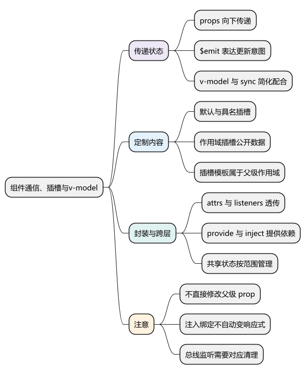
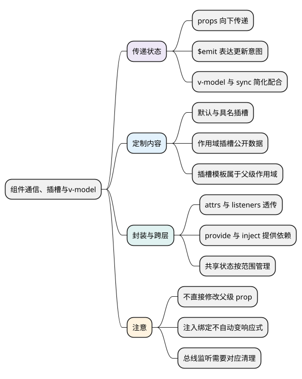
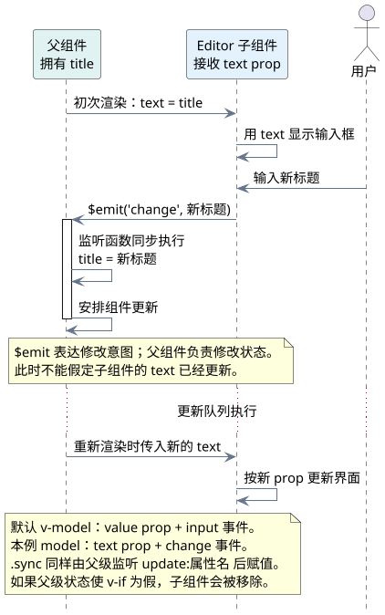

# 组件通信、插槽与v-model

<!-- core-mindmap:start -->
[](examples/v2b04-mindmap.svg)

<details>
<summary>PlantUML 源码</summary>



</details>

<!-- core-mindmap:end -->

**口述总览：** 父组件通过 prop 提供数据，子组件通过事件表达修改意图，由父组件更新状态。`v-model`、`.sync` 简化了这套配合；插槽把部分界面的决定权交给父组件；`$attrs`、`$listeners` 则帮助封装组件把属性和监听传到合适的位置。

本文使用 Vue 2.7.16 Options API；`v-slot` 是 Vue 2.6 起提供的写法。

## props 与 $emit()：明确谁拥有和修改状态

下面是配套的父子单文件组件。父组件拥有标题和显示状态，子组件只发事件请求更新，还提供具名插槽和带数据的默认插槽。

<!-- project: v2b04-editor; file: App.vue -->
```vue
<template>
  <main>
    <Editor v-if="open" v-model="title" :open.sync="open">
      <template #heading><h2>编辑标题</h2></template>
      <template #default="{ length }">已输入 {{ length }} 个字符</template>
    </Editor>
    <button v-else @click="open = true">重新编辑</button>
    <p>父组件标题：{{ title }}</p>
  </main>
</template>

<script>
import Editor from './Editor.vue'
export default {
  components: { Editor },
  data() {
    return { title: 'Vue 2 复习', open: true }
  }
}
</script>
```

<!-- project: v2b04-editor; file: Editor.vue -->
```vue
<template>
  <section>
    <slot name="heading"><h2>标题</h2></slot>
    <input :value="text" @input="$emit('change', $event.target.value)"
      aria-label="标题">
    <p><slot :length="text.length">请输入标题</slot></p>
    <button @click="$emit('update:open', false)">关闭</button>
  </section>
</template>

<script>
export default {
  name: 'Editor',
  model: { prop: 'text', event: 'change' },
  props: {
    text: { type: String, default: '' },
    open: { type: Boolean, default: true }
  }
}
</script>
```

prop 应声明类型和合理默认值，对象、数组默认值使用返回新值的函数。开发环境的 prop 校验有助于发现问题，但不是对不可信接口数据的完整验证。

子组件不要直接给 prop 赋值，也不要借助对象引用偷偷修改父组件的嵌套状态。对象内部修改可能不会出现同样的警告，但会破坏状态归属；通常应发事件，由拥有状态的一方处理。

## v-model 与 .sync：简写属性和事件的配合

Vue 2 自定义组件的 `v-model` 默认使用 `value` prop 和 `input` 事件。本例通过 `model` 改为 `text` 和 `change`，所以父组件的 `v-model="title"` 对应传入 `text`，收到 `change` 后更新 `title`。

`:open.sync="open"` 对应传入 `open`，监听子组件的 `update:open` 事件并赋值。`.sync` 的表达式需要可以赋值，不能写成计算表达式或函数调用。

这两种写法仍然遵循“属性向下、事件向上”，并没有授予子组件直接修改父组件状态的权限。Vue 2 不能照搬 Vue 3 的 `v-model:open` 写法。

<!-- understanding-flow: v2b04-component-data-flow:start -->
<a id="v2b04-component-data-flow"></a>

以本例的标题编辑为例，真正修改 `title` 的仍然是父组件；子组件发事件时，新的 prop 还没有因此立即传回来。

<details>
<summary>PlantUML 源码</summary>



</details>

<!-- understanding-flow: v2b04-component-data-flow:end -->

## slot 与 v-slot：让调用方决定局部内容

`<slot>` 是默认插槽，`<slot name="heading">` 是具名插槽；标签内部是没有传入内容时使用的后备内容。父组件通过 `v-slot:heading` 或简写 `#heading` 填充。

插槽内容默认在**定义它的父组件作用域**中求值，不能直接读取子组件局部变量。子组件通过 `<slot :length="text.length">` 公开数据，父组件再从 `#default="{ length }"` 接收，这就是作用域插槽。

Vue 2.6 项目优先使用 `v-slot`。旧项目里的 `slot`、`slot-scope` 需要能读懂，但新整理的示例不再把新旧语法混在一起。

## $attrs 与 $listeners：封装可透传的输入组件

下面的独立组件可以直接在父组件中使用 `v-model`，并把 `placeholder`、`disabled` 等属性及 `focus`、`blur` 等监听传到内部输入框。

<!-- example: v2b04-base-input -->
```vue
<template>
  <label>
    <span>{{ label }}</span>
    <input v-bind="$attrs" :value="value" v-on="inputListeners">
  </label>
</template>

<script>
export default {
  name: 'BaseInput',
  inheritAttrs: false,
  props: {
    label: { type: String, default: '内容' },
    value: { type: String, default: '' }
  },
  computed: {
    inputListeners() {
      return Object.assign({}, this.$listeners, {
        input: event => this.$emit('input', event.target.value)
      })
    }
  }
}
</script>
```

这里单独处理 `input`，向父级传字符串；其他事件继续透传，避免把整个 DOM 事件当作模型值。箭头函数在普通计算属性方法内部创建，捕获的是该方法的组件 `this`。

Vue 2 的 `$attrs` 不包含已声明的 prop，也不包含 `class`、`style`；`$listeners` 包含父级的组件事件监听，不包含 `.native` 监听。`inheritAttrs: false` 关闭未声明属性自动落到根元素，但不阻止 `class`、`style` 合并到根元素。

## 跨层与非父子通信：按状态范围选择

祖先可通过 `provide()` 提供依赖，后代通过 `inject` 接收。Vue 2 的注入绑定本身不自动建立响应式；提供已有响应式对象时，后代读取其属性仍能追踪变化。提供一个基本值快照，不会因为祖先变量后来改变就自动同步。

兄弟组件可以把状态提升到共同父组件；跨页面共享状态可使用 [Vuex 3](08_Vuex3与状态管理.md)。事件总线的 `$on` 注册应与 `$off(event, handler)` 清理配对，保留同一函数引用，不能无条件移除其他组件的监听。清理时机见[生命周期与资源清理](05_生命周期、KeepAlive与资源清理.md)。

`$refs` 适合聚焦、重置等明确的公开操作；`$parent`、`$children` 会把组件绑定到具体树形结构，不宜成为常规数据流。不要把“事件总线优先于 Vuex”当作固定规则。

<a id="interview"></a>

## 试题

<a id="v2b04-01"></a>

### V2B04-01 [P0·基础] 子组件需要修改父组件传来的值，应该怎么做？

通过 `$emit` 发出事件和必要数据，父组件在监听中更新自己拥有的状态。`v-model`、`.sync` 都是在简化这种配合。子组件直接修改对象 prop 的内部字段可能影响父组件，但这不是推荐的通信约定。

<a id="v2b04-02"></a>

### V2B04-02 [P0·基础] Vue 2 的组件 v-model 与 .sync 有什么区别？

`v-model` 默认约定 `value` 和 `input`，可以用 `model` 选项改成另一组 prop、事件；`.sync` 用于指定属性，约定事件名为 `update:属性名`，可用于多个独立属性。两者都需要子组件发出对应事件，不能直接把父级状态改掉。

<a id="v2b04-03"></a>

### V2B04-03 [P0·基础] 作用域插槽里的数据来自哪里？

插槽模板由父组件提供，默认读取父组件作用域。子组件在 `<slot>` 上绑定的数据作为插槽参数传出，父组件通过 `v-slot` 接收后使用。因此它允许父组件决定怎么展示子组件提供的数据，而不是让父组件随意读取子组件全部状态。

<a id="v2b04-04"></a>

### V2B04-04 [P1·理解] 封装输入组件时，为什么经常一起使用 inheritAttrs、$attrs 和 $listeners？

外层根元素可能是标签或容器，属性和事件真正需要落到内部输入框。关闭默认属性继承后，可以用 `$attrs` 把属性绑定到输入框，用 `$listeners` 透传事件，并针对 `input` 转换参数。还要记住 Vue 2 的 `class`、`style` 和 `.native` 不在这两个集合中。

参考：[Vue 2 自定义组件事件](https://v2.vuejs.org/v2/guide/components-custom-events.html)、[插槽](https://v2.vuejs.org/v2/guide/components-slots.html)、[依赖注入](https://v2.vuejs.org/v2/api/#provide-inject)。
