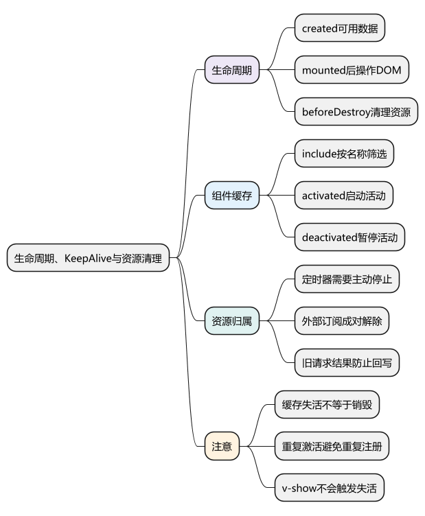
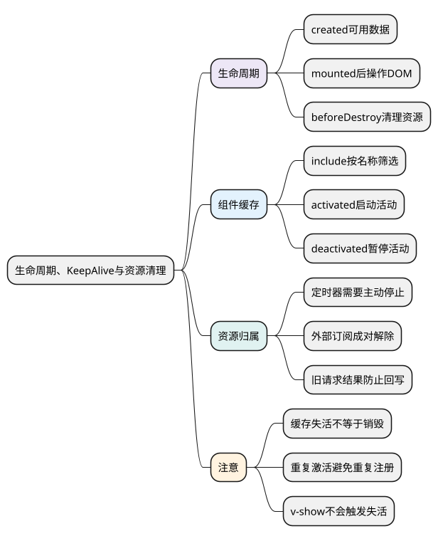
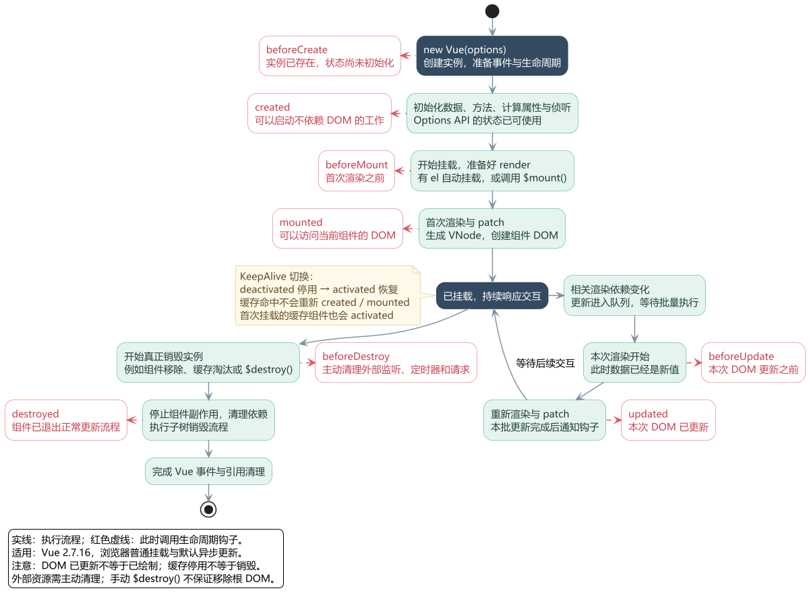
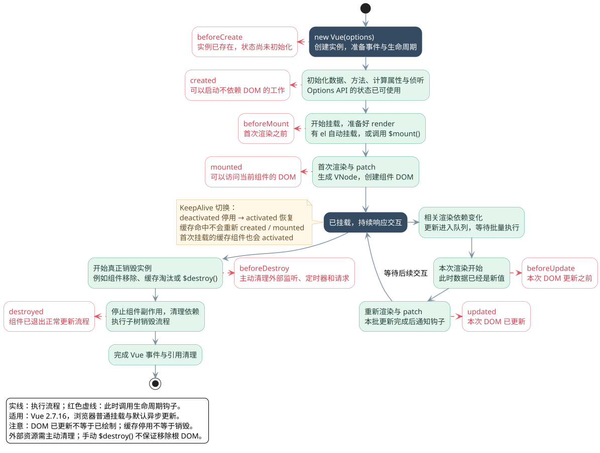

# 生命周期、KeepAlive与资源清理

<!-- core-mindmap:start -->
[](examples/v2b05-mindmap.svg)

<details>
<summary>PlantUML 源码</summary>



</details>

<!-- core-mindmap:end -->

**口述总览：** 生命周期提供组件创建、挂载、更新和销毁的执行时机。Vue 2 在 `created` 中可以使用数据，在 `mounted` 后可以操作自己的 DOM；缓存组件暂时离开时执行 `deactivated`，真正销毁时才执行销毁钩子。定时器、外部事件和订阅需要按这些时机主动清理。

<!-- lifecycle-flow:start -->
<a id="lifecycle-flow"></a>

沿实线看创建、挂载、更新与销毁，红色虚线表示在相邻阶段调用生命周期钩子，调用完成后再继续主流程。KeepAlive 的停用与恢复单独标注；需要看模板编译分支时，进入[完整执行流程](../04_Vue2原理与源码/01_初始化与挂载流程.md#lifecycle-flow)。点击图片可放大查看。

[](examples/v2b05-lifecycle-flow.svg)

<details>
<summary>PlantUML 源码</summary>



</details>

<!-- lifecycle-flow:end -->

## 生命周期：按数据和 DOM 是否就绪安排工作

- `beforeCreate`：Options API 的 `data`、`computed` 和 `methods` 还没有完成初始化。
- `created`：可以访问数据和方法，适合启动不依赖 DOM 的工作；还不能访问当前组件已挂载的 DOM。
- `beforeMount` / `mounted`：首次渲染前 / 挂载完成后。同步子组件会先于父组件完成挂载。
- `beforeUpdate` / `updated`：本次 DOM 更新前 / 更新后，前者看到的响应式数据已经是新值。
- `beforeDestroy` / `destroyed`：销毁开始前 / 销毁完成后。清理通常放在 `beforeDestroy`，这时实例仍可正常使用。

`created` 每创建一个组件实例执行一次；切换路由后重新创建实例，也会再次执行，并不是整个应用只执行一次。Vue 不会等待异步 `created` 中的请求完成才挂载，应通过加载状态控制界面。

修改数据后要读取新 DOM，使用 `await this.$nextTick()`。它等待这次 Vue 更新完成，不保证浏览器已经把像素绘制到屏幕上；不要在 `updated` 中无条件修改驱动本组件渲染的状态。

## KeepAlive：离开时保留实例，再次进入时恢复

`<keep-alive>` 是内置缓存组件，常包住动态组件或 `<router-view>`。普通切换可能销毁旧实例；被缓存的组件切换出去后仍保留状态，再次进入时复用实例。

- `include` / `exclude`：按组件名称筛选，可传逗号分隔字符串、正则或数组；组件应设置 `name`。
- `max`：最多缓存多少个实例，超过限制会淘汰较久未使用的缓存。
- `activated`：首次挂载后，以及从缓存恢复时调用。
- `deactivated`：退出活动状态、进入缓存时调用；销毁缓存树时也可能调用，清理应允许重复执行。

缓存命中后不会重新执行 `created`、`mounted`，但仍可能因为数据变化而更新。缓存也不会自动暂停组件中的定时器和外部订阅。

## 缓存计时器：显示时启动，隐藏和销毁时停止

以下两个文件构成一个例子。点击隐藏再显示，计数保留；隐藏期间不继续计数。`mounted` 和 `activated` 都调用启动函数，通过检查已有定时器避免重复注册，也兼容组件没有被缓存的用法。

<!-- project: v2b05-cache-cleanup; file: CachedClock.vue -->
```vue
<template>
  <p>活动计数：{{ ticks }}，窗口宽度：{{ width }}</p>
</template>

<script>
export default {
  name: 'CachedClock',
  data() {
    return { ticks: 0, width: 0, timer: null }
  },
  mounted() {
    this.start()
  },
  activated() {
    this.start()
  },
  deactivated() {
    this.stop()
  },
  beforeDestroy() {
    this.stop()
  },
  methods: {
    onResize() {
      this.width = window.innerWidth
    },
    start() {
      if (this.timer !== null) return
      this.onResize()
      window.addEventListener('resize', this.onResize)
      this.timer = window.setInterval(() => {
        this.ticks += 1
      }, 1000)
    },
    stop() {
      window.clearInterval(this.timer)
      this.timer = null
      window.removeEventListener('resize', this.onResize)
    }
  }
}
</script>
```

<!-- project: v2b05-cache-cleanup; file: App.vue -->
```vue
<template>
  <div>
    <button @click="shown = !shown">显示 / 隐藏计时器</button>
    <keep-alive :include="['CachedClock']" :max="2">
      <CachedClock v-if="shown" />
    </keep-alive>
  </div>
</template>

<script>
import CachedClock from './CachedClock.vue'

export default {
  components: { CachedClock },
  data() {
    return { shown: true }
  }
}
</script>
```

如果页面需要“离开后仍继续工作”，应把工作放到明确拥有它的上层服务或状态模块中；不要依赖组件意外存活。请求也不会随失活或销毁自动取消，要使用取消能力，或者用请求序号忽略过期结果。

## 资源清理：找到真正持有回调的对象

Vue 会处理组件自身的渲染依赖和组件事件；自行注册到 `window`、事件总线、第三方库的监听器，以及定时器，需要自行解除。移除监听时要使用原来的函数引用；不要重新创建一个看起来相同的匿名函数。

`this.$watch()`、Vuex 的 `store.subscribe()` 等会返回停止或取消订阅函数。按实际需要在 `deactivated` 停止活动期间才需要的订阅，在 `beforeDestroy` 做最终清理；重新激活时需要重新注册。不要在每次 `activated` 都新增订阅却不解除旧订阅。

`v-show` 只改变显示样式，不会触发销毁，也不会触发缓存失活；需要响应可见性的任务，应另外监听显示条件。

<a id="interview"></a>

## 试题

<a id="v2b05-01"></a>

### V2B05-01 [P0·基础] created 和 mounted 应该怎么选？

不依赖 DOM 的数据初始化可以在 `created` 中进行；需要当前组件真实 DOM 的工作放在 `mounted` 中。异步请求放在哪里都不会让 Vue 自动等待它完成，页面需要显式处理加载和失败状态。异步子组件也不保证在父组件 `mounted` 时全部就绪。

<a id="v2b05-02"></a>

### V2B05-02 [P0·基础] 缓存页面再次进入，为什么 mounted 不执行？

因为复用的是已经挂载过的实例，不是创建新实例。每次进入都要执行的工作应放在 `activated`；只需执行一次的工作保留在 `created` 或 `mounted`。缓存被淘汰、实例被销毁后重新进入，才会重新创建和挂载。

<a id="v2b05-03"></a>

### V2B05-03 [P0·工程] 页面离开后仍不断请求，应该检查什么？

先区分页面是销毁、缓存失活还是仅被 `v-show` 隐藏，再检查定时器、外部订阅和未完成请求的所有者。缓存页面通常要在 `deactivated` 暂停轮询，在 `activated` 恢复，并在 `beforeDestroy` 兜底清理。还要避免重复启动，以及旧请求完成后覆盖新页面状态。

<a id="v2b05-04"></a>

### V2B05-04 [P1·原理] beforeDestroy 和 destroyed 有什么区别？

前者在销毁流程开始前调用，实例仍可正常工作；后者在组件的观察、子组件等销毁流程完成后调用。手动资源通常在 `beforeDestroy` 中解除更直接。Vue 的销毁不会替你撤销独立的网络请求，也不会自动找到所有注册在外部对象上的监听器。

进一步阅读：[组件更新、生命周期与KeepAlive](../04_Vue2原理与源码/07_组件更新、生命周期与KeepAlive.md)。
