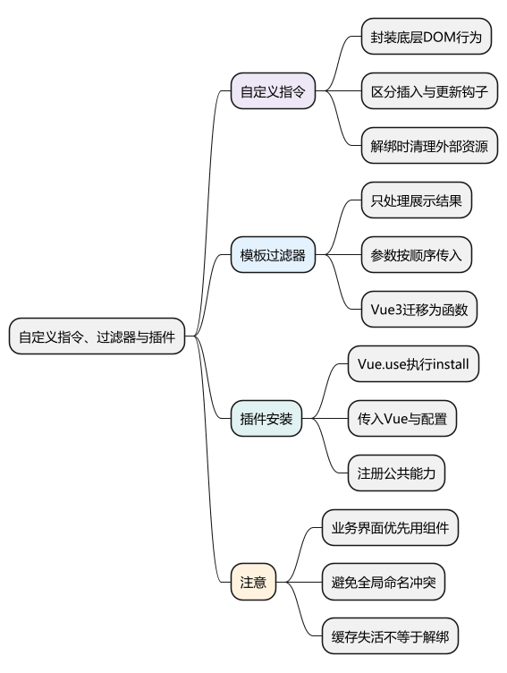
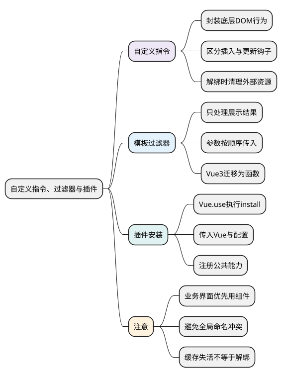
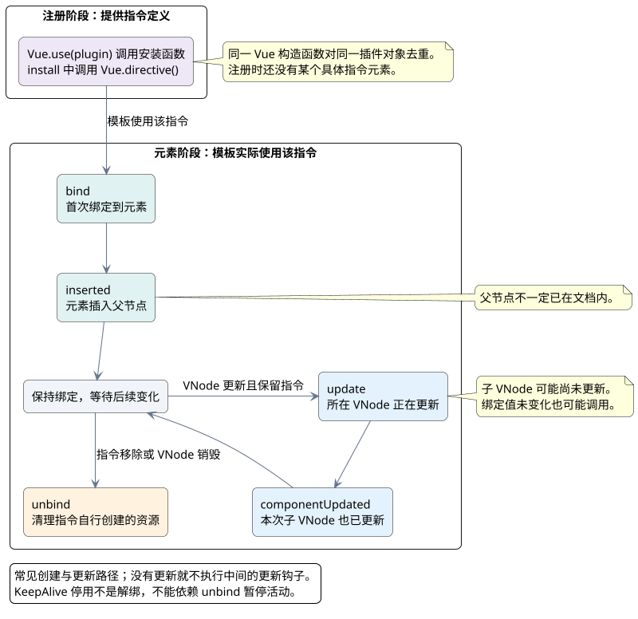

# 自定义指令、过滤器与插件

<!-- core-mindmap:start -->
[](examples/v2b06-mindmap.svg)

<details>
<summary>PlantUML 源码</summary>



</details>

<!-- core-mindmap:end -->

**口述总览：** Vue 2 的自定义指令封装直接操作 DOM 的行为，过滤器处理模板中的展示格式，插件通过 `Vue.use()` 给应用安装公共能力。三者解决的问题不同：业务界面优先用组件，状态计算优先用计算属性，确实需要操作底层元素时再写指令。

## 自定义指令：在合适时机操作元素

局部指令写在组件的 `directives` 选项中，全局指令使用 `Vue.directive('名称', 定义)`。模板使用时加 `v-`，例如注册 `focus` 后写 `v-focus`。

Vue 2 的指令钩子是：

- `bind`：首次绑定时调用一次，适合设置初始状态或注册监听器。
- `inserted`：元素插入父节点后调用；父节点不一定已经位于文档中。
- `update`：所在组件的 VNode 更新时调用，子 VNode 可能尚未更新；绑定值没有变化也可能调用。
- `componentUpdated`：所在组件及其子 VNode 都完成更新后调用。
- `unbind`：解绑时调用一次，适合解除指令自行注册的监听器。

<!-- understanding-flow: v2b06-directive-stages:start -->
<a id="v2b06-directive-stages"></a>

下面以插件注册全局指令为例，区分注册能力与使用元素的时机；局部 `directives` 无需经过 `Vue.use()`。

<details>
<summary>PlantUML 源码</summary>



</details>

<!-- understanding-flow: v2b06-directive-stages:end -->

常用参数是 `el` 和 `binding`。`el` 是元素；`binding.value` 是本次值，`binding.oldValue` 是更新前的值，`binding.arg` 是冒号后的参数，`binding.modifiers` 是修饰符集合。不要修改 `binding`；需要跨钩子保存状态，可使用 `WeakMap`。

例如 `v-color:background.red="color"` 中，`arg` 是 `background`，`modifiers.red` 是 `true`。参数、修饰符和绑定值的意义由指令作者定义，不会自动产生颜色处理逻辑。

## 过滤器：格式化显示值，不承担状态修改

局部过滤器定义在 `filters` 中，全局过滤器使用 `Vue.filter()` 注册。模板中可写 `{{ price | money('CNY') }}`，`price` 会作为过滤器的第一个参数，后续参数依次传入。

过滤器适用于文本插值和 `v-bind` 表达式，不应用于 `v-model`、事件处理或异步请求。应返回展示结果，不修改原数据；它也不等同于带缓存的计算属性。复杂派生状态使用 `computed`，通用格式化逻辑使用普通函数。

**Vue 3 已移除模板过滤器语法。** 维护 Vue 2 可以识别和使用它，迁移时改成函数调用或计算属性。

## Vue.use()：一次安装公共能力

插件可以是带 `install` 方法的对象，也可以是函数。`Vue.use(plugin, options)` 会把 Vue 构造函数和配置传给安装函数，同一个插件对象重复安装不会重复执行安装逻辑。

以下示例在已配置 Vue 2 单文件组件编译的项目中运行。插件注册金额过滤器和实例方法，组件使用局部指令聚焦输入框。金额处理采用 `Intl.NumberFormat`，不改变输入数据。

<!-- project: v2b06-extensions; file: format-plugin.js -->
```javascript
export default {
  install(Vue, options = {}) {
    const locale = options.locale || 'zh-CN'
    const money = (value, currency = 'CNY') => {
      if (value === null || value === undefined || value === '') return '—'
      const amount = Number(value)
      if (!Number.isFinite(amount)) return '—'
      return new Intl.NumberFormat(locale, {
        style: 'currency', currency
      }).format(amount)
    }
    Vue.filter('money', money)
    Vue.prototype.$money = money
  }
}
```

<!-- project: v2b06-extensions; file: main.js -->
```javascript
import Vue from 'vue'
import App from './App.vue'
import FormatPlugin from './format-plugin.js'

Vue.use(FormatPlugin, { locale: 'zh-CN' })
new Vue({ render: h => h(App) }).$mount('#app')
```

<!-- project: v2b06-extensions; file: App.vue -->
```vue
<template>
  <div>
    <input v-focus v-model.number="price" type="number" aria-label="价格">
    <p>{{ price | money('CNY') }}</p>
    <button @click="showMessage">生成价格提示</button>
    <p>{{ message }}</p>
  </div>
</template>

<script>
export default {
  directives: {
    focus: {
      inserted(el) {
        el.focus()
      }
    }
  },
  data() {
    return { price: 12.5, message: '' }
  },
  methods: {
    showMessage() {
      this.message = `当前价格：${this.$money(this.price)}`
    }
  }
}
</script>
```

项目需要 HTML 挂载节点 `<div id="app"></div>`。聚焦例子针对插入当前文档的输入框；如果父容器尚未加入文档，应在真正显示后再聚焦。首次聚焦不等于每次重新显示都会聚焦。

## 使用边界：减少全局影响和资源遗漏

操作焦点、测量、第三方 DOM 库接入适合指令；具有界面结构和业务状态的功能适合组件。不要在指令里随意改动由 Vue 管理的子节点，否则可能与后续渲染冲突。

插件中的全局指令、过滤器、`Vue.prototype` 成员会影响使用同一个 Vue 构造函数的组件，名称要避免冲突。不要把每个工具函数都变成实例属性，也不要用全局 mixin 给所有组件偷偷增加副作用。

如果指令注册了 `document` 事件、观察器或定时器，必须在 `unbind` 中清理。指令解绑和缓存失活不是同一个事件；组件只是被 KeepAlive 缓存时，不能依赖 `unbind` 来暂停工作。

<a id="interview"></a>

## 试题

<a id="v2b06-01"></a>

### V2B06-01 [P0·基础] 自定义指令与组件怎么选择？

指令针对已有元素补充 DOM 行为，例如聚焦或测量；组件负责可复用的界面、状态和交互。一个业务弹窗通常应是组件；弹窗内输入框自动聚焦可以用指令。只做普通数据计算，不需要引入指令。

<a id="v2b06-02"></a>

### V2B06-02 [P0·基础] update 和 componentUpdated 有什么区别？

`update` 在所在组件的 VNode 更新时调用，但其子 VNode 可能还没更新；`componentUpdated` 在它们都更新后调用。两者不是只在绑定值变化时触发，必要时比较 `binding.value` 与 `binding.oldValue`。对象原地修改时两者可能指向同一个对象，不能把引用比较当作深度变化检测。

<a id="v2b06-03"></a>

### V2B06-03 [P0·基础] 过滤器会改变原数据吗，Vue 3 还能用吗？

正常的过滤器应只返回格式化结果，不修改输入数据；但 Vue 不会禁止你在函数中写副作用，所以仍需遵守这个约定。Vue 3 不再支持模板过滤器，应改为普通格式化函数或计算属性。过滤器也不提供计算属性那样的依赖缓存。

<a id="v2b06-04"></a>

### V2B06-04 [P1·工程] Vue.use() 和 import 有什么区别？

`import` 加载模块并取得导出值；`Vue.use()` 按 Vue 插件约定执行安装，把组件、指令或实例方法等能力注册到 Vue。普通工具函数直接导入使用即可。插件重复安装检测针对同一个插件对象；它不意味着任何名字相同的插件都能自动去重。
