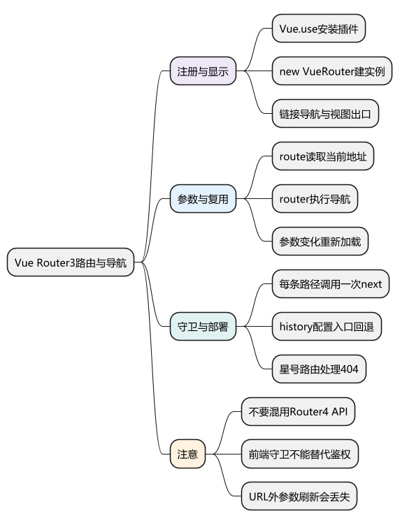
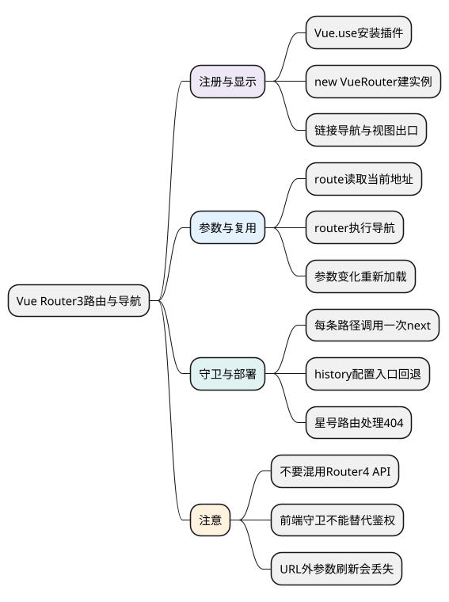
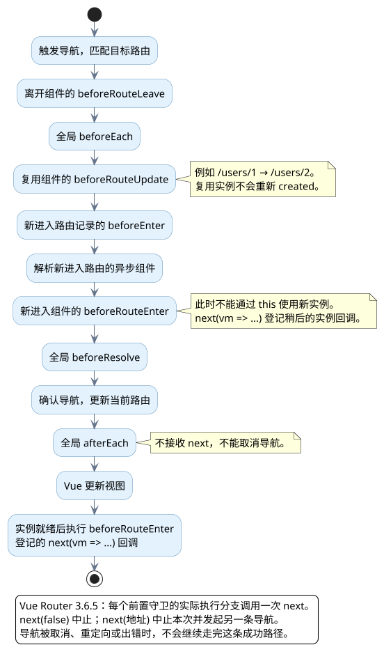

# Vue Router3路由与导航

<!-- core-mindmap:start -->
[](examples/v2b07-mindmap.svg)

<details>
<summary>PlantUML 源码</summary>



</details>

<!-- core-mindmap:end -->

**口述总览：** Vue Router 3 把 URL 和 Vue 2 组件对应起来，用 `router-link` 发起导航，用 `router-view` 显示匹配组件。`$route` 表示当前地址信息，`$router` 提供导航能力；守卫负责决定能否继续导航，参数变化时要考虑组件复用。

## 安装与注册：Vue 2 配合 Vue Router 3

本文使用 Vue 2.7.16、Vue Router 3.6.5。先 `Vue.use(VueRouter)` 安装插件，再 `new VueRouter()` 创建实例，最后把 `router` 注入根 Vue 实例。不要混用 Router 4 的 `createRouter()`、`createWebHistory()` 或只返回结果的守卫写法。

下面是一个完整的路由配置例子，放在已支持 Vue 2 单文件组件的项目中。首页和 404 用短渲染函数定义，用户页使用单文件组件。

<!-- project: v2b07-router; file: router.js -->
```javascript
import Vue from 'vue'
import VueRouter from 'vue-router'
import UserPage from './UserPage.vue'

Vue.use(VueRouter)

const router = new VueRouter({
  mode: 'hash',
  routes: [
    { path: '/', component: { render: h => h('p', '首页') } },
    {
      path: '/users/:id', name: 'user', component: UserPage,
      props: true, meta: { title: '用户详情' }
    },
    { path: '*', component: { render: h => h('p', '404：页面不存在') } }
  ]
})

router.beforeEach((to, from, next) => {
  if (to.name === 'user' && !/^\d+$/.test(to.params.id)) {
    return next('/')
  }
  next()
})

router.afterEach(to => {
  document.title = to.meta.title || '用户中心'
})

export default router
```

<!-- project: v2b07-router; file: main.js -->
```javascript
import Vue from 'vue'
import App from './App.vue'
import router from './router.js'

new Vue({ router, render: h => h(App) }).$mount('#app')
```

<!-- project: v2b07-router; file: App.vue -->
```vue
<template>
  <div>
    <nav>
      <router-link to="/" exact>首页</router-link>
      <router-link :to="{ name: 'user', params: { id: '1' } }">用户一</router-link>
      <router-link :to="{ name: 'user', params: { id: '2' }, query: { tab: 'profile' } }">
        用户二
      </router-link>
      <router-link to="/missing">未知页面</router-link>
    </nav>
    <router-view />
  </div>
</template>

<script>
export default { name: 'App' }
</script>
```

<!-- project: v2b07-router; file: UserPage.vue -->
```vue
<template>
  <p>用户 {{ id }}：{{ name }}，页签：{{ $route.query.tab || 'overview' }}</p>
</template>

<script>
const users = { 1: '小明', 2: '小红' }

export default {
  props: { id: { type: String, required: true } },
  data() {
    return { name: '' }
  },
  watch: {
    id: {
      immediate: true,
      handler(id) {
        this.name = users[id] || '未找到该用户'
      }
    }
  }
}
</script>
```

项目的 HTML 需要有 `<div id="app"></div>`。点击用户一、用户二时，路由复用 `UserPage` 实例，监听 `id` 会更新展示结果；若换成真实请求，还需要处理加载、失败以及旧请求覆盖新结果的竞态。

## 参数与导航：区分地址信息和导航操作

- `$route.params.id`：动态路径参数，例如 `/users/1` 中的 `1`。`props: true` 会把它传给路由组件，减少组件与路由的耦合。
- `$route.query.tab`：查询参数，例如 `?tab=profile`。外部 URL 输入需要校验，不能假定一定是合法数字或单个字符串。
- `$router.push({ name: 'user', params: { id: '2' } })`：按名称生成地址并增加一条历史记录；使用 `path` 时应自己组成路径，`params` 不会替你填入它。
- `$router.replace('/users/2')`：替换当前记录；`$router.go(-1)`：尝试返回上一条历史记录。

需要刷新后保留的数据应放在 URL 中，或采用明确的持久化机制。Router 3 可以传入未声明在路径中的 `params`，但这类信息没有进入 URL，刷新后不能依赖它仍存在。

嵌套路由通过 `children` 定义，子路径通常不写开头的 `/`，父页面中再放一个 `<router-view>`。`redirect` 用于地址重定向；路由懒加载通常写成 `component: () => import('./UserPage.vue')`。

## 导航守卫：每条执行路径只调用一次 next

`beforeEach(to, from, next)` 的 `next()` 放行，`next(false)` 取消，`next('/login')` 改为发起另一条导航，`next(error)` 中止并交给错误处理。示例中 `return next('/')` 的 `return` 是为了结束当前 JavaScript 函数，防止下面再执行一次 `next()`。

常用守卫还包括路由独享的 `beforeEnter`、组件内的 `beforeRouteEnter` / `beforeRouteUpdate` / `beforeRouteLeave`、全局的 `beforeResolve`。`afterEach` 是导航后的通知，不接收 `next`，不能取消导航。

`beforeRouteEnter` 时新实例还未创建，不能使用 `this`，可以通过 `next(vm => { /* 使用实例 */ })` 访问实例。参数变化复用组件时，可选侦听参数或 `beforeRouteUpdate`；不要只在 `created` 请求数据，也不要两处重复发请求。

<!-- understanding-flow: v2b07-navigation-guards:start -->
<a id="v2b07-navigation-guards"></a>

下面是一条成功导航的顺序。只执行这次导航涉及的守卫：复用的路由记录走更新守卫，新进入的记录才走进入守卫。

<details>
<summary>PlantUML 源码</summary>



</details>

<!-- understanding-flow: v2b07-navigation-guards:end -->

登录守卫可检查 `to.matched` 中路由记录的 `meta`，但登录页本身要放行以避免重定向循环。前端守卫负责交互，服务端仍必须验证接口身份与权限。

## 路由模式与 404：区分浏览器导航和服务器响应

`hash` 模式把客户端路径放在 `#` 后；`history` 模式使用正常路径，需要服务器对前端页面路径返回应用入口。静态资源和 API 请求应有独立规则，不能把任何 404 都改成 HTML。

Router 3 使用 `{ path: '*', component: ... }` 匹配未命中页面，放在路由表末尾。前端 404 界面不等于服务器返回了 HTTP 404。部署在子目录时，还要让 `base`、静态资源路径与服务器配置一致。

<a id="interview"></a>

## 试题

<a id="v2b07-01"></a>

### V2B07-01 [P0·基础] $route 和 $router 有什么区别？

`$route` 是当前路由信息，可读取 `path`、`params`、`query`、`matched` 等；`$router` 是路由实例，用来执行 `push`、`replace`、`go` 等操作。不要靠直接修改 `$route` 来跳转，应调用导航 API。

<a id="v2b07-02"></a>

### V2B07-02 [P0·基础] 用户详情从 id 为 1 切到 2，为什么 created 没执行？

两条地址匹配同一个组件时，Router 通常复用现有实例，因而不会重新创建。监听目标参数或使用 `beforeRouteUpdate` 来更新数据即可。使用 `props: true` 时可直接监听 `id`；用请求加载时还要防止较早请求最后返回并覆盖新数据。

<a id="v2b07-03"></a>

### V2B07-03 [P0·工程] 导航卡住或重复跳转，先检查什么？

检查 Router 3 守卫每条路径是否恰好调用一次 `next`：漏调会一直等待，重复调用会破坏导航流程。再检查重定向目标是否也被同一个条件拦截、异步校验的异常是否处理。不要从 Router 4 示例中照搬只 `return false` 的写法。

<a id="v2b07-04"></a>

### V2B07-04 [P0·工程] history 模式页面能点击进入，刷新却 404，为什么？

站内导航由浏览器中的 Router 处理；刷新会直接向服务器请求完整路径。服务器如果没有对应文件或前端入口回退规则，就会返回 404。需要正确配置前端页面路径的入口回退，同时保留 API、静态文件以及真实错误响应的边界。
