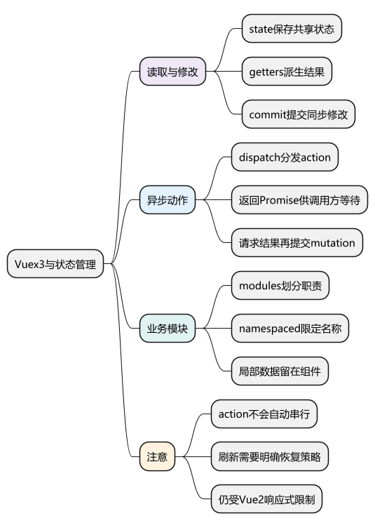
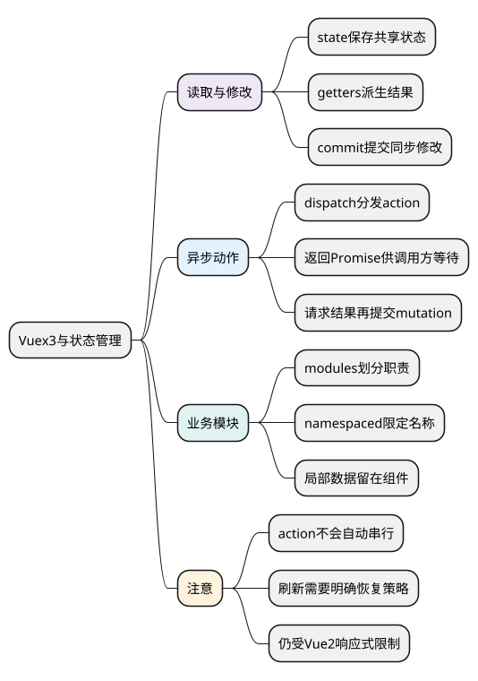
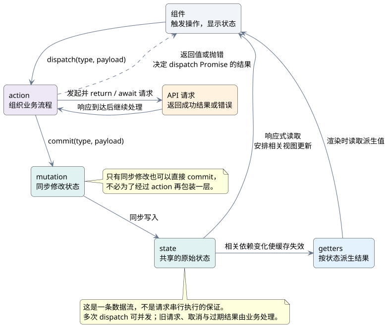

# Vuex3与状态管理

<!-- core-mindmap:start -->
[](examples/v2b08-mindmap.svg)

<details>
<summary>PlantUML 源码</summary>



</details>

<!-- core-mindmap:end -->

**口述总览：** Vuex 3 用于组织 Vue 2 中需要跨组件共享的状态。组件读取 `state` 或 `getters`，用 `commit` 提交同步修改，用 `dispatch` 执行业务动作；异步请求通常放在 `actions` 中，结果再交给 `mutations` 写入。并不是所有组件数据都要放入仓库。

## 核心 API：读取状态、提交修改、执行动作

- `state`：原始状态；组件通过计算属性读取，或用 `mapState` 映射。
- `getters`：从状态派生结果；可直接读取，或用 `mapGetters` 映射。
- `mutations`：同步修改状态，通过 `store.commit(type, payload)` 调用。
- `actions`：组织流程，可执行异步操作，通过 `store.dispatch(type, payload)` 调用，再用 `commit` 修改状态。
- `modules`：按业务拆分状态与逻辑；`namespaced: true` 给模块的 getter、mutation 和 action 加上模块路径前缀。

`mapState`、`mapGetters` 放在组件的 `computed` 中，`mapMutations`、`mapActions` 放在 `methods` 中。`dispatch` 返回 Promise，但 action 必须返回内部异步操作，调用方才能正确等待其完成。

<!-- understanding-flow: v2b08-store-data-flow:start -->
<a id="v2b08-store-data-flow"></a>

把异步业务流程与同步状态修改分开看：等待 `dispatch` 是等待 action 返回的结果，读取新 DOM 仍需在状态修改后等待 Vue 的更新。

<details>
<summary>PlantUML 源码</summary>



</details>

<!-- understanding-flow: v2b08-store-data-flow:end -->

## 模块仓库：同步计数与异步动作配合使用

以下项目使用 Vue 2.7.16 和 Vuex 3.6.2。先 `Vue.use(Vuex)`，再创建仓库并注入根实例。异步例子用短定时器模拟等待，不依赖外部接口。

<!-- project: v2b08-store; file: store.js -->
```javascript
import Vue from 'vue'
import Vuex from 'vuex'

Vue.use(Vuex)

export default new Vuex.Store({
  strict: true, // 教学与开发检查；生产中通常关闭，避免深度检查成本
  modules: {
    counter: {
      namespaced: true,
      state: () => ({ count: 0 }),
      getters: {
        double: state => state.count * 2
      },
      mutations: {
        add(state, amount) {
          state.count += amount
        }
      },
      actions: {
        async addLater({ commit }, amount) {
          await new Promise(resolve => setTimeout(resolve, 100))
          commit('add', amount)
          return '已完成'
        }
      }
    }
  }
})
```

<!-- project: v2b08-store; file: main.js -->
```javascript
import Vue from 'vue'
import App from './App.vue'
import store from './store.js'

new Vue({ store, render: h => h(App) }).$mount('#app')
```

<!-- project: v2b08-store; file: App.vue -->
```vue
<template>
  <div>
    <p>计数：{{ count }}，两倍：{{ double }}</p>
    <button @click="add(1)">立即加一</button>
    <button :disabled="pending" @click="increaseLater">稍后加一</button>
    <p>{{ message }}</p>
  </div>
</template>

<script>
import { mapState, mapGetters, mapMutations, mapActions } from 'vuex'

export default {
  data() {
    return { pending: false, message: '' }
  },
  computed: {
    ...mapState('counter', ['count']),
    ...mapGetters('counter', ['double'])
  },
  methods: {
    ...mapMutations('counter', ['add']),
    ...mapActions('counter', ['addLater']),
    async increaseLater() {
      if (this.pending) return
      this.pending = true
      try {
        this.message = await this.addLater(1)
      } catch (error) {
        this.message = error.message
      } finally {
        this.pending = false
      }
    }
  }
}
</script>
```

项目的 HTML 需要有 `<div id="app"></div>`。按钮的 `pending` 和提示文案只属于当前界面，保留在组件；共享计数放到模块中。

没有辅助函数时，读取计数写 `this.$store.state.counter.count`，读取派生值写 `this.$store.getters['counter/double']`，提交和分发分别写 `this.$store.commit('counter/add', 1)`、`this.$store.dispatch('counter/addLater', 1)`。

## 命名空间：模块内部用局部名称，跨模块明确目标

开启命名空间后，组件使用完整的模块路径；模块 action 中的 `commit('add', amount)` 默认提交当前模块的 mutation。需要访问根状态时使用 action 上下文的 `rootState`，需要提交根 mutation 时传第三个参数 `{ root: true }`。

模块并不等于多个互不相关的仓库，仍归属于同一棵状态树。可复用模块使用 `state: () => ({ ... })`，每次创建新状态对象，避免多个实例意外共享状态。

Vuex 3 基于 Vue 2 响应式。对象新增属性、直接修改数组索引等限制同样存在，优先预先声明字段；必要时在 mutation 中使用 `Vue.set` 或 `splice`。

## 异步与持久化：仓库不会自动解决竞态和刷新恢复

示例的按钮防止当前组件重复提交，但其他组件仍可分发同一个 action。Vuex 不会自动串行化 action，也不会自动取消请求。搜索、详情加载等以最新请求为准的场景，应使用请求序号或取消机制，防止旧响应最后返回并覆盖新结果。

组件销毁也不会自动停止已经执行的 action。任务究竟属于单个页面还是共享业务，要先明确；页面所属任务可以取消，共享任务可能应该继续完成。不要把“使用 Vuex”当作清理资源的替代方案。

刷新后仓库会重新初始化，需要恢复的数据应从接口或经过校验的持久化数据中恢复。持久化要选择字段并考虑版本、有效期和退出登录后的清理；敏感信息不能因为放进 Vuex 就被认为安全。

属性方式读取 getter 类似计算属性，按响应式依赖缓存；getter 返回函数供参数查询时，每次调用该函数仍会执行查询，不会自动为每个参数缓存结果。

<a id="interview"></a>

## 试题

<a id="v2b08-01"></a>

### V2B08-01 [P0·基础] commit 和 dispatch 有什么区别？

`commit` 触发 mutation，用于同步修改状态；`dispatch` 触发 action，用于组织业务流程，可包含异步操作。action 通过 `commit` 写入状态。调用方需要等待流程时，应让 action 返回或等待内部 Promise，再 `await dispatch(...)`。

<a id="v2b08-02"></a>

### V2B08-02 [P0·基础] mutation 为什么要求同步，action 必须异步吗？

同步 mutation 让每次状态变更有明确的开始和结束，便于跟踪与调试；把异步回调放进 mutation，会让真正的状态变化脱离这次提交。action 可以同步，也可以异步，其职责是组织流程，不是“只能写异步代码”。

<a id="v2b08-03"></a>

### V2B08-03 [P0·工程] 多个页面共享状态，都放 Vuex 合适吗？

确实跨页面共享且需要统一管理的业务状态适合仓库。局部输入、弹窗开关等通常留在组件；能从已有状态派生的值用 getter 或计算属性。先明确数据的所有者、生命周期和修改入口，避免仓库成为所有临时变量的集合。

<a id="v2b08-04"></a>

### V2B08-04 [P1·工程] 使用 Vuex 后，搜索结果还会被旧请求覆盖吗？

会。多个 action 可以同时执行，响应先后不一定等于发起先后，mutation 只是按实际提交顺序同步修改。应给请求编号并只接收最新结果，或取消过期请求；加载标记、错误状态也应遵循同样的请求归属规则。共享仓库本身不会解决网络竞态。
