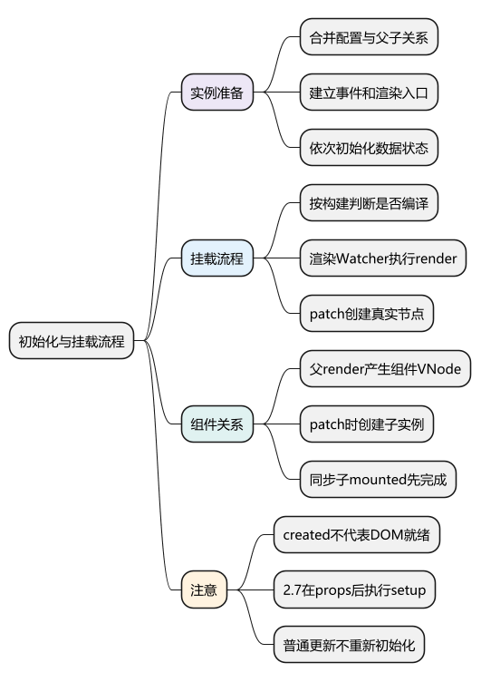
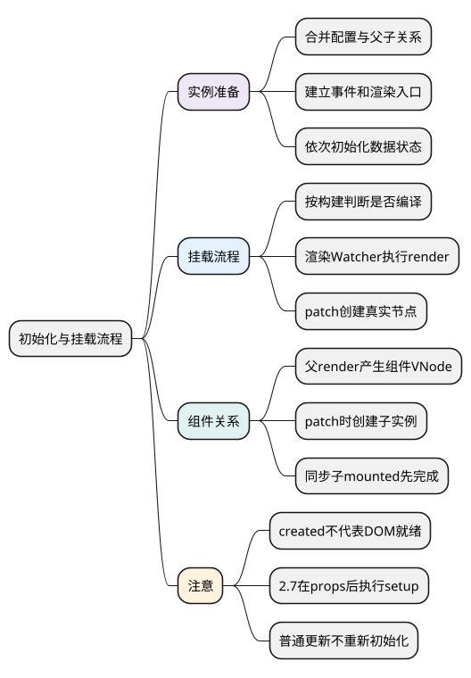
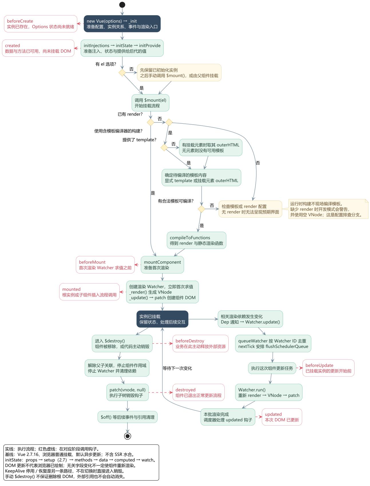
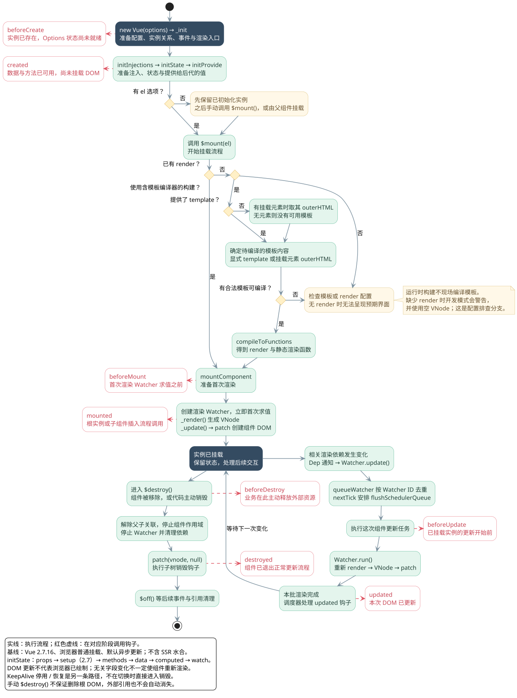

# 初始化与挂载流程：从 new Vue 到页面出现

<!-- core-mindmap:start -->
[](examples/v2s01-mindmap.svg)

<details>
<summary>PlantUML 源码</summary>



</details>

<!-- core-mindmap:end -->

**口述总览：** Vue 2 创建组件时，先合并配置、建立父子关系和事件，再初始化数据与方法。挂载时，渲染 Watcher 执行渲染函数，生成描述页面的 VNode，再由 patch 创建真实 DOM。初始化完成不等于已经挂载；后续数据更新会重新执行渲染和 patch，通常不会重新创建组件实例。

源码基线：**Vue 2.7.16，浏览器端普通有状态组件的 Options API 路径**。本篇先理解实例如何进入第一次渲染，再去下一篇理解渲染时如何收集依赖。

<!-- lifecycle-flow:start -->
<a id="lifecycle-flow"></a>

先沿正常路径追踪一次完整过程，再看 `el`、`render` 与模板编译的分支。红框是生命周期钩子，虚线表示在该阶段调用，完成后继续实线流程；右侧更新分支可以重复发生，销毁分支表示实例真正结束。点击图片可放大查看。

[](examples/v2s01-lifecycle-flow.svg)

<details>
<summary>PlantUML 源码</summary>



</details>

模板编译得到的是 **render 函数**，执行 render 才生成 VNode，随后 patch 创建或更新 DOM。图中的配置排查分支只解释缺少可用 render 时为何不能呈现预期界面，不展开所有编译错误路径。

本篇继续展开初始化与挂载；更新阶段详见[异步更新队列与 nextTick](04_异步更新队列与nextTick.md)，销毁、父子钩子顺序与缓存详见[组件更新、生命周期与 KeepAlive](07_组件更新、生命周期与KeepAlive.md)。

<!-- lifecycle-flow:end -->

## 观察初始化与挂载：created 时有数据，mounted 时有 DOM

下面例子在已加载 Vue 2.7.16 的浏览器环境运行，`Vue` 为框架入口。使用手写 render，因此运行时构建也可以运行。若用 Node 验证 DOM，需要先建立 jsdom 环境再加载 Vue。

<!-- example: v2s01-mount-order -->

```js
const steps = []
const host = document.createElement('div')
document.body.appendChild(host)

const vm = new Vue({
  data() {
    steps.push('data')
    return { count: 1 }
  },
  beforeCreate() {
    steps.push(`beforeCreate:${this.count}`)
  },
  created() {
    steps.push(`created:${this.count}`)
  },
  beforeMount() {
    steps.push('beforeMount')
  },
  render(h) {
    steps.push(`render:${this.count}`)
    return h('p', String(this.count))
  },
  mounted() {
    steps.push(`mounted:${this.$el.textContent}`)
  }
})

console.log(steps.join(','))
// beforeCreate:undefined,data,created:1
console.log(vm.$el === undefined) // true

vm.$mount(host)
console.log(steps.join(','))
// beforeCreate:undefined,data,created:1,beforeMount,render:1,mounted:1
console.log(host === vm.$el) // false：这个挂载点被渲染出的 p 替换

vm.$destroy()
vm.$el.remove()
```

`new Vue()` 没传 `el` 时，实例已初始化，但不会自动开始挂载。传入 `el` 会在 `_init` 的最后调用 `$mount`；组件内部创建的子实例则由组件 VNode 的钩子继续挂载。

`created` 里的数据可以使用，是因为数据初始化发生在它之前。`beforeCreate` 的含义也不是“Vue 对象尚不存在”：执行钩子时实例已经存在，只是 Options API 的状态还没初始化好。

## _init：按依赖顺序准备组件实例

普通实例的主线可以按下面的顺序读：

```text
new Vue(options)
→ _init(options)
→ 合并选项，建立 $options
→ initLifecycle：父子关系与生命周期状态
→ initEvents：组件自定义事件
→ initRender：插槽、创建 VNode 的辅助入口等
→ beforeCreate
→ initInjections
→ initState
→ initProvide
→ created
→ 有 el 时调用 $mount
```

这些名称对应真实源码函数，但没有要求把所有内部字段背下来。最重要的是理解顺序解决了什么依赖：

- `inject` 先解析，使后面的 data 等初始化逻辑可以使用注入值。
- 状态初始化后再执行 `provide`，便于把当前实例的数据提供给后代。
- 自定义事件和渲染辅助设施提前准备，使实例创建期间的组件协作有可用入口。

根实例通常走完整的选项合并；由父组件创建的内部组件可以走 `initInternalComponent` 的优化路径。两者最终都要准备好实例所需状态，不必机械认为每次创建都完整遍历全局配置。

## initState：区分经典 Options 顺序和 Vue 2.7 的补充

经典 Options API 的主要顺序是：

```text
props → methods → data → computed → watch
```

在本系列固定的 **2.7.16** 中，`initState` 实际在 props 后增加了 Composition API 的 `initSetup`：

```text
props → setup → methods → data → computed → watch
```

所以，不能把旧版 Vue 2 的源码截图直接当成 2.7 的完整执行顺序。`setup` 可以使用已准备的 props，但不应依赖此时尚未初始化的 Options data、methods 或 computed。

`initData` 会拿到 data 返回的对象，为合适的字段设置实例转发入口，并调用 `observe` 做响应式处理。能写 `this.count`，是因为实例把访问转发到内部数据对象；这和 Vue 3 用 Proxy 创建响应式代理不是一回事。

不要把同名字段冲突背成一套可依赖的优先级。props、methods、data、computed 重名会造成警告或覆盖风险，业务设计应让名称表达唯一职责。

## $mount：判断是否需要编译，再进入 mountComponent

运行时构建负责执行已经存在的 render；包含编译器的完整构建在没有 render 时，还可以把 template 编译成 render。

```text
已有 render ───────────────────────┐
template → 编译器生成 render ───────┤
                                  ↓
                         mountComponent
```

工程里的 `.vue` 文件通常在构建阶段已经处理模板，因此“项目写了 template”不等于“浏览器每次挂载都要编译模板”。

`mountComponent` 先执行 `beforeMount`，随后准备更新函数：

```text
updateComponent
→ vm._render()：运行 render，得到 VNode
→ vm._update(vnode)：进入 patch，创建或更新 DOM
```

渲染 Watcher 的 getter 就是这个更新过程。它在首次创建时立即求值，因此第一次页面渲染是同步启动的；后续响应式修改通常通过调度队列重新运行它。

## 首次 patch：遇到组件节点时继续创建子实例

VNode 是用于描述标签、属性、子节点或组件的 JavaScript 对象，并不等于真实 DOM。父组件 render 创建子组件的占位 VNode；patch 处理它时，才继续创建子组件实例并挂载其渲染结果。

因此不能说“父组件执行 render 之前，子组件已经先执行 render”。普通同步父子组件是父实例先初始化，父渲染在前，处理子节点时再进入子组件。

子组件的 `mounted` 通过组件 VNode 的插入钩子进入；根实例在 `mountComponent` 的相应分支处理。普通同步嵌套场景下，表现为子组件 mounted 在父组件 mounted 前。

异步组件和服务端渲染要另外分析，不能把这条观察推广到所有后代、所有平台。mounted 也不意味着图片加载、请求返回或浏览器绘制已经完成。

## 固定源码入口：沿调用链逐段定位

- [实例入口与 _init](https://github.com/vuejs/vue/blob/v2.7.16/src/core/instance/init.ts)：看选项合并和钩子位置。
- [initState](https://github.com/vuejs/vue/blob/v2.7.16/src/core/instance/state.ts)：核对 props、setup 和 Options 状态的顺序。
- [浏览器运行时入口](https://github.com/vuejs/vue/blob/v2.7.16/src/platforms/web/runtime/index.ts)：看 `$mount` 与平台 patch 如何接入。
- [包含编译器的入口](https://github.com/vuejs/vue/blob/v2.7.16/src/platforms/web/runtime-with-compiler.ts)：看 template 如何变成 render。
- [mountComponent 与 _update](https://github.com/vuejs/vue/blob/v2.7.16/src/core/instance/lifecycle.ts)：看 Watcher 如何连接 render 与 patch。
- [组件 VNode 钩子](https://github.com/vuejs/vue/blob/v2.7.16/src/core/vdom/create-component.ts)：看子实例的创建与 mounted。

阅读时先在例子的 beforeCreate、created、render、mounted 打断点，再把每个观察对应到入口。这样能验证“哪个状态何时可用”，不用一次抄下几百行源码。

## 工程追问：为什么有数据却没有页面

先分清失败发生在哪一段：实例是否创建、是否调用挂载、有没有合法 render、模板是否经过正确的编译器处理、render 有没有抛错。

如果控制台提示运行时构建不支持 template，优先检查项目的模板编译配置和 Vue 入口；不是随意加一个 nextTick 就能解决。

如果在 created 访问 `$refs` 得到空值，应把依赖真实 DOM 的操作移到 mounted，或在条件渲染更新后等待 `$nextTick`。请求初始化可以在更早阶段发起，两种工作不需要强行放在同一个钩子。

如果每次父级更新都导致子组件重建，检查 key、组件类型和 `v-if` 分支。正常更新复用实例，`_init` 不应因为一次普通 prop 变化而重新走一遍。

<a id="interview"></a>

## 试题

<a id="v2s01-01"></a>

### V2S01-01 [P0·原理] 从 new Vue 到页面出现，主要经过哪些步骤？

**回答：** 先在 `_init` 中合并配置、建立父子关系和事件，初始化注入、数据、计算属性与侦听器，然后执行 created。有 el 或手动调用 `$mount` 后进入挂载；若需要运行时模板编译，先得到 render。渲染 Watcher 运行 render 产生 VNode，再通过 patch 创建真实 DOM。遇到子组件时会继续创建其实例并挂载，最终进入 mounted。

<a id="v2s01-02"></a>

### V2S01-02 [P0·原理] 为什么 created 能读 data，却通常不能操作组件 DOM？

**回答：** data、computed、watch 等状态在 created 前已经初始化，但挂载发生在 created 之后，此时 render 和 patch 还未完成。需要首次 DOM 的逻辑应放 mounted；需要条件更新后的 DOM，则在修改状态后等待 `$nextTick`。created 和 mounted 都不保证异步请求完成。

<a id="v2s01-03"></a>

### V2S01-03 [P1·源码] Vue 2.7 的初始化顺序与常见 Vue 2 老教程有什么差别？

**回答：** 老教程常列 props、methods、data、computed、watch；2.7.16 的 `initState` 在 props 后、methods 前调用 `initSetup`，支持回移的 Composition API。它仍保留 Vue 2 的 Observer/Watcher 响应式体系，不能因此认为已经使用 Vue 3 的 Proxy。读源码要先固定版本，再确认讨论的是 Options API 还是 setup 路径。

<a id="v2s01-04"></a>

### V2S01-04 [P1·场景] 项目使用 .vue 模板，却选择 runtime-only 构建，为什么能运行？

**回答：** `.vue` 模板通常由构建工具和对应编译器预先转成 render，浏览器只需执行生成的函数并完成响应式更新和 patch。runtime-only 缺的是浏览器内的模板编译能力，不是组件渲染能力。只有把未经预编译的 template 字符串直接交给运行时，才需要调整编译链或使用包含编译器的构建。
