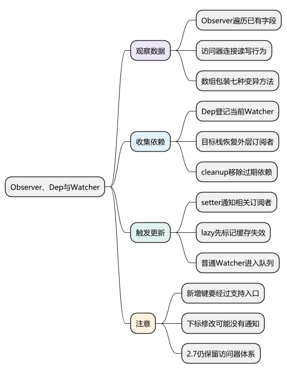
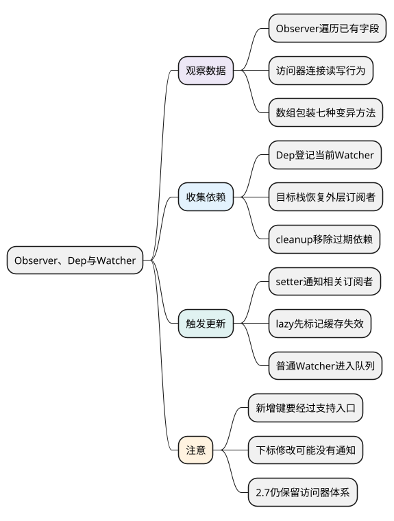
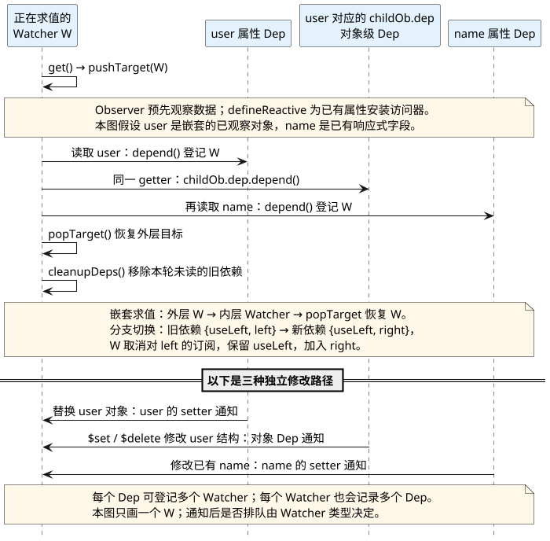

# Observer、Dep 与 Watcher：连接数据读取和更新

<!-- core-mindmap:start -->
[](examples/v2s02-mindmap.svg)

<details>
<summary>PlantUML 源码</summary>



</details>

<!-- core-mindmap:end -->

**口述总览：** Observer 负责把数据变成可观察的数据，Dep 负责记录谁用过数据，Watcher 负责执行需要重新运行的逻辑。Watcher 运行时读取属性，属性 getter 收集它；修改属性触发 setter，Dep 通知相关 Watcher。组件渲染通常进入更新队列，计算属性则先让缓存失效。

源码基线：**Vue 2.7.16，浏览器端默认异步更新配置**。本篇的“代理到实例”指通过访问器转发字段，不是 Vue 3 的 Proxy 响应式实现。

## 观察分支依赖：不再读取的属性会退出订阅

例子需要加载 Vue 2.7.16，`Vue` 为框架入口。它不挂载 DOM，因此可以直接在已引入 Vue 的 Node 环境观察。每次修改后等待 tick，避免把不同阶段合并成一次更新。

<!-- example: v2s02-branch-deps -->

```js
async function observeBranch() {
  const vm = new Vue({
    data: () => ({ useLeft: true, left: 1, right: 10 })
  })
  let reads = 0
  const values = []
  const stop = vm.$watch(
    function () {
      reads++
      return this.useLeft ? this.left : this.right
    },
    value => values.push(value)
  )

  vm.right = 11
  await Vue.nextTick()
  console.log(reads, values.join(',')) // 1, ''：right 尚未被读取

  vm.useLeft = false
  await Vue.nextTick()
  console.log(reads, values.join(',')) // 2, '11'

  vm.left = 2
  await Vue.nextTick()
  console.log(reads, values.join(',')) // 2, '11'：已移除 left 的旧依赖

  vm.right = 12
  await Vue.nextTick()
  console.log(reads, values.join(',')) // 3, '11,12'

  stop()
  vm.$destroy()
}
observeBranch()
```

这里记录 getter 的执行次数，而不只看 watch 回调次数，是为了区分“根本没有重新求值”和“求值后发现结果没变”。两种情况都可能表现为回调没有输出，但依赖行为不同。

## Observer：给已有字段安装读写入口

`observe(value)` 会检查值是否适合观察、是否已有 Observer，然后创建或复用观察结果。普通对象经过 `Object.keys` 遍历已有可枚举字段，由 `defineReactive` 安装 getter/setter；嵌套的可观察对象继续处理。

Observer 会通过内部 `__ob__` 关联到原对象，以复用观察结果并保存对象级依赖。这个内部字段适合源码定位，不应成为业务代码依赖的公共 API。

```text
initData
→ observe(data)
→ new Observer(data)
→ 对象：逐字段 defineReactive
→ 数组：增强变异方法并观察元素
```

不是任意 JavaScript 值都会变成深度响应式对象。原始值、不可扩展对象以及某些框架明确跳过的对象有不同分支，不能把“递归处理”理解成无条件遍历一切。

## Dep：分别记录属性读取和对象结构依赖

`defineReactive` 为属性创建 Dep；Observer 自己也带有 Dep，用于对象新增、删除以及数组变异等变化的通知。

读取一个已有响应式属性时，getter 主要做这些事：

- 返回当前值。
- 若存在活动 Watcher，通过属性 Dep 收集依赖。
- 值包含子 Observer 时，按源码分支收集对象级依赖；数组还需要处理元素相关依赖。

因此，“每个属性一个 Dep”可以用于入门，但不足以解释 `$set` 和数组 `push` 为什么也能通知更新。它们往往依赖对象或数组的 Observer 所持有的 Dep。

依赖关系是多对多：一个字段可能被多个组件和计算属性读取，一个 Watcher 也可能读取多个字段。不是一个字段只能对应一个 Watcher。

## Watcher：执行 getter 时收集依赖，结束后清理依赖

Watcher 中的 getter 是“这次需要执行的函数”，不一定是对象属性的 getter：

- 渲染 Watcher 的 getter 执行组件 render 和 patch。
- computed Watcher 的 getter 计算派生结果。
- 用户 Watcher 的 getter 读取 `$watch` 指定的数据源。

其核心求值过程是：

```text
Watcher.get()
→ pushTarget(this)：记录当前正在求值的 Watcher
→ 执行 getter，触发响应式属性读取
→ Dep.depend() → Watcher.addDep(dep)
→ deep 模式下遍历结果，继续触发读取
→ popTarget()：恢复外层目标
→ cleanupDeps()：移除本轮没再读取的依赖
```

`Dep.target` 是当前收集目标。为什么还需要栈？因为组件 render 可能读取 computed，computed 又需要临时成为活动 Watcher。内部计算结束后必须恢复外层渲染 Watcher，否则后面的读取会登记给错误对象。

`deps/newDeps` 保存前后两轮依赖，配合 ID 集合避免重复登记。求值结束后，本轮没再出现的旧 Dep 会取消对该 Watcher 的订阅，这正是前面分支例子中 left 不再触发求值的原因。

<!-- understanding-flow: v2s02-dependency-links:start -->
<a id="v2s02-dependency-links"></a>

把一次 `this.user.name` 的读取展开，就能区分属性 Dep 和对象 Dep。箭头表示登记或通知关系；对象级 Dep 由 `user` 的 Observer 持有，不是 `name` 属性的 Dep。

<details>
<summary>PlantUML 源码</summary>



</details>

<!-- understanding-flow: v2s02-dependency-links:end -->

## 更新通知：不同 Watcher 不采用同一种执行时机

```text
属性 setter
→ 更新值，必要时观察新对象
→ dep.notify()
→ Watcher.update()
   ├─ lazy：dirty = true
   ├─ sync：立即 run()
   └─ 默认：queueWatcher，等待批量执行
```

computed 的依赖变化通常只是让缓存失效，等下次读取才重新计算。普通渲染和默认用户 watch 通常排队。因此不能背“computed Watcher、用户 Watcher、渲染 Watcher 始终按三种类别依次执行”。

`run()` 会再次求值，用户 watch 再根据新旧结果、对象类型和 deep 等条件判断是否调用回调。依赖触发、Watcher 求值、用户回调执行是三个不同步骤。

## 数组和新增属性：理解为什么需要受支持的入口

Vue 2 不逐个拦截所有数组索引，也不能自动拦截未来的对象键。它包装 `push`、`pop`、`shift`、`unshift`、`splice`、`sort`、`reverse`：执行原操作，观察插入项，再通知数组依赖。

<!-- example: v2s02-array-notification -->

```js
async function observeArray() {
  const vm = new Vue({ data: () => ({ items: [1, 2] }) })
  const values = []
  const stop = vm.$watch(
    () => vm.items.join(','),
    value => values.push(value)
  )

  vm.items[0] = 9
  await Vue.nextTick()
  console.log(values.length) // 0：数组内容已变，但没有对应通知

  vm.$set(vm.items, 0, 8)
  await Vue.nextTick()
  console.log(values.join('|')) // 8,2：set 的数组分支使用 splice

  stop()
  vm.$destroy()
}
observeArray()
```

对象的新键应通过 `$set` 添加，删除通过 `$delete`，数组索引替换用 `splice` 或 `$set`。已经直接添加的非响应式键，再对同名键调用 `$set` 不一定补上访问器，因为它会命中“已有属性直接赋值”分支。

根 data 应提前声明字段；不能依赖 `$set` 随意补充 Vue 实例或根 data 的响应式结构。Vue 2.7 回移 Composition API 后，这些底层限制也没有统一变成 Proxy 行为。

## 固定源码入口：按观察、收集、通知三个动作阅读

- [Observer、defineReactive、set、del](https://github.com/vuejs/vue/blob/v2.7.16/src/core/observer/index.ts)：看属性 Dep 与 Observer 的 Dep 分别在哪里使用。
- [Dep 与目标栈](https://github.com/vuejs/vue/blob/v2.7.16/src/core/observer/dep.ts)：看 depend、notify、pushTarget、popTarget。
- [Watcher](https://github.com/vuejs/vue/blob/v2.7.16/src/core/observer/watcher.ts)：看 get、addDep、cleanupDeps、update 和 teardown。
- [数组变异方法](https://github.com/vuejs/vue/blob/v2.7.16/src/core/observer/array.ts)：看插入项处理和通知入口。

## 工程追问：数据变了但页面没变，沿哪条链排查

先确认修改的是模板实际读取的响应式对象，再检查新增属性、数组下标和引用替换是否经过通知入口。随后确认组件是否真的依赖该字段，以及更新是否尚在队列里。

“再点另一个按钮页面突然更新”常见于未通知的变更被其他一次 render 顺便读到。它说明当前页面与数据暂时失去同步，并不说明直接数组索引写入已经变成可靠响应式操作。

依赖清理减少无关更新，但不能替代业务资源清理。window 监听、定时器、外部缓存仍可能持有组件或数据引用；退出页面时必须按资源所有权释放。

<a id="interview"></a>

## 试题

<a id="v2s02-01"></a>

### V2S02-01 [P0·原理] Observer、Dep、Watcher 各自负责什么？

**回答：** Observer 观察对象或数组，为属性安装访问器、为数组接入变异通知；Dep 保存并通知订阅者；Watcher 执行渲染、计算或侦听等逻辑。Watcher 求值时读取数据，getter 通过 Dep 建立依赖，setter 或数组变异再通知对应 Watcher。Watcher 根据类型同步执行、标记缓存失效或进入调度队列。

<a id="v2s02-02"></a>

### V2S02-02 [P1·源码] 为什么依赖收集需要目标栈和 cleanupDeps？

**回答：** render 内部读取 computed 等场景会嵌套求值，目标栈让内部 Watcher 完成后恢复外层 Watcher，避免依赖登记错对象。cleanupDeps 比较本轮与上一轮依赖，移除条件分支切换后不再使用的订阅，减少无效更新和旧引用。两者分别解决“当前替谁收集”和“哪些旧关系还需要保留”。

<a id="v2s02-03"></a>

### V2S02-03 [P0·原理] Vue 2 为什么可以响应 push，却不能可靠响应数组下标赋值？

**回答：** Vue 2 包装了会改变数组的七种方法，在原操作之后观察新增项并通知数组依赖；它没有为所有数组下标安装完整访问器，因此直接下标赋值可能只改变内容而不通知。替换索引可用 splice 或 `$set`。已有数组元素对象中已观察字段的修改仍可响应，要与替换整个元素区分。

<a id="v2s02-04"></a>

### V2S02-04 [P1·场景] 不更新的数据在其他操作后突然显示正确，说明什么？

**回答：** 很可能是数据确实被修改，但这次修改绕过了响应式通知；另一个操作触发 render 后，才读到了新值。应检查直接新增键、数组索引修改、错误对象引用等原因，并用受支持入口修正。`$forceUpdate` 或反复 nextTick 不能替代正确的数据通知链，也不应作为常规补丁。
