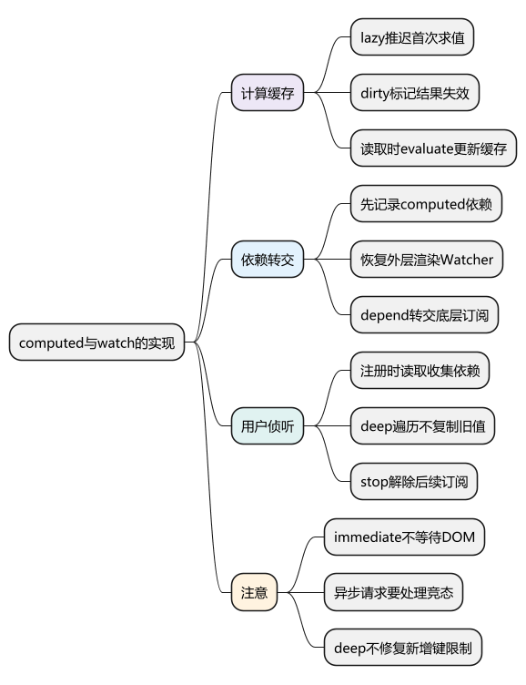
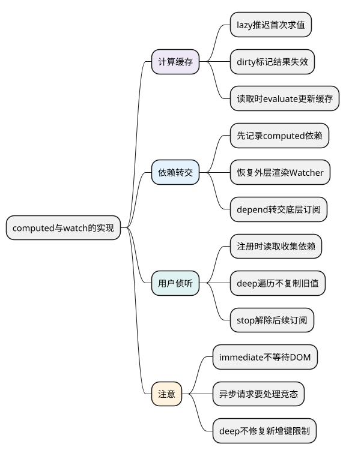
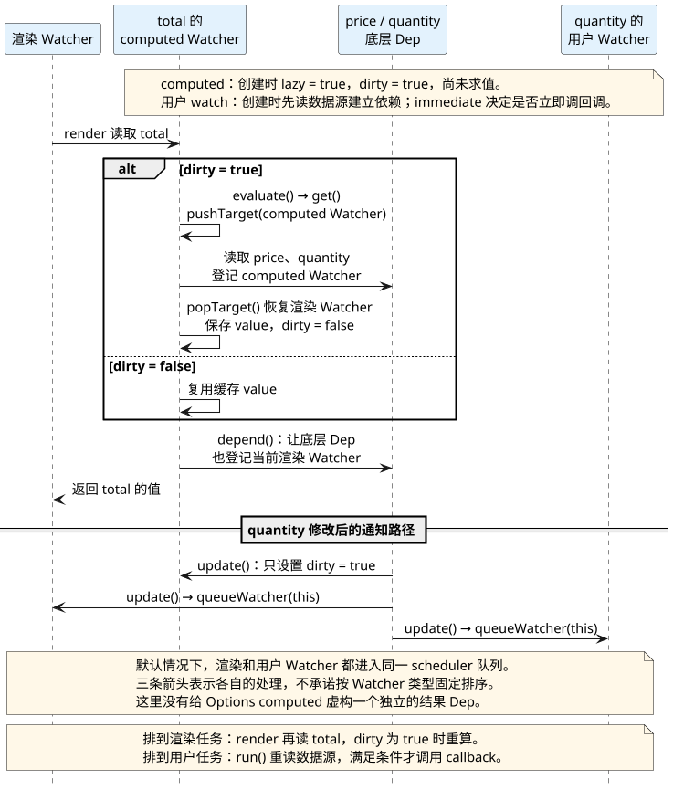

# computed 与 watch 的实现：缓存派生值和执行副作用

<!-- core-mindmap:start -->
[](examples/v2s03-mindmap.svg)

<details>
<summary>PlantUML 源码</summary>



</details>

<!-- core-mindmap:end -->

**口述总览：** computed 用懒求值的 Watcher 保存结果，依赖变化时先让缓存失效，下次读取才重算；watch 用用户 Watcher 读取数据源，在更新后比较结果并执行回调。两者都依赖数据读取时的依赖收集，但 computed 主要提供派生值，watch 主要处理请求、日志等副作用。

源码基线：**Vue 2.7.16 的 Options API computed、watch 和 `$watch`，非服务端渲染路径**。Vue 2.7 的 Composition API watch 有额外选项，不能把 Vue 3 的所有 watch 能力直接套到 `$watch`。

## 观察 computed：依赖变了，不代表马上重新计算

下面例子只需要已引入的 Vue 2.7.16，不需要 DOM。

<!-- example: v2s03-computed-cache -->

```js
let evaluations = 0
const vm = new Vue({
  data: () => ({ price: 10, quantity: 2, remark: '' }),
  computed: {
    total() {
      evaluations++
      return this.price * this.quantity
    }
  }
})

console.log(evaluations) // 0：创建 computed 尚未求值
console.log(vm.total, vm.total, evaluations) // 20 20 1

vm.remark = 'memo'
console.log(vm.total, evaluations) // 20 1：未读取 remark，不依赖它

vm.quantity = 3
console.log(evaluations) // 1：此刻只是缓存失效
console.log(vm.total, evaluations) // 30 2：读取时才重算
vm.$destroy()
```

如果计算函数只读取 `Date.now()`，它没有可通知 Vue 的响应式依赖，不能指望时间流逝让缓存自动刷新。需要一个明确更新的响应式时间源，或者按场景使用普通方法。

## initComputed：为计算属性准备 lazy Watcher

初始化时，Vue 为普通 computed 创建 Watcher，并传入 `lazy: true`。Watcher 初始 `dirty` 为 true，但不会立即执行 getter；实例上的计算属性读取入口由 `defineComputed` 建立。

```text
initComputed
→ new Watcher(getter, { lazy: true })
→ 定义实例的 computed getter
→ 首次读取
→ dirty 为 true，执行 evaluate()
→ 保存 value，dirty 改为 false
→ 后续读取直接返回 value
```

依赖的 setter 通知 Watcher 时，lazy 分支只是设置 `dirty = true`。如果之后无人读取该 computed，就没有必要为它重新求值。

“缓存”并不表示永久保存第一次结果，而是只要已收集的依赖没发生相关变更，就复用上次计算结果。

## depend：让外层渲染也订阅底层依赖

假设模板读取 total，而 total 内部读取 price 和 quantity。求值时有两个角色：组件渲染 Watcher，以及 total 的 computed Watcher。

```text
渲染 Watcher 开始 render
→ 读取 total
→ computed Watcher 暂时成为 Dep.target
→ 读取 price、quantity，登记 computed Watcher
→ computed 求值结束，恢复渲染 Watcher
→ computed Watcher.depend()
→ 让底层 Dep 同时登记当前渲染 Watcher
```

因此 price 变化时，一方面 computed 被标记为 dirty，另一方面使用它的渲染 Watcher 获得更新通知。等 render 再次读 total 时，才得到重新计算后的结果。

Vue 2.7.16 的 Options computed 在这里通过 `watcher.depend()` 转交底层依赖，不能直接画成“computed 自带一个独立 Dep，所有订阅者都只订阅它”并当作该版本源码。

在普通未挂载实例上读取 computed 也有缓存，不要求先有渲染 Watcher。只有当前确实存在外层订阅者时，才需要做依赖转交。

<!-- understanding-flow: v2s03-computed-dependencies:start -->
<a id="v2s03-computed-dependencies"></a>

沿 `total = price * quantity` 看两件不同的事：读取时计算和转交依赖，修改时标记失效和安排更新。图中的用户 Watcher 单独侦听 quantity，用来对照 computed 的懒求值。

<details>
<summary>PlantUML 源码</summary>



</details>

<!-- understanding-flow: v2s03-computed-dependencies:end -->

## $watch：先求值收集依赖，再在变化时调用回调

Options 的 watch 最终通过 `initWatch → createWatcher → $watch` 归一化处理。`$watch` 创建用户 Watcher，把数据源转换为 getter，并立即求值以记录初始值和依赖。

```text
$watch(source, callback, options)
→ 创建 user Watcher
→ 初次 get()：收集依赖并保存 value
→ immediate 为 true 时额外执行一次 callback
→ 数据触发后排队
→ run() 再次 get()
→ 满足回调条件时传入 newValue、oldValue
```

**初次读取不等于初次执行回调。** 没有 immediate 时也要读取数据源，否则无法建立依赖；immediate 控制的是回调是否在注册时立刻调用。

字符串数据源只支持简单点路径，如 `user.name`。表达式、条件判断、拼接结果应使用函数 getter，不能把任意 JavaScript 表达式塞进路径字符串。

## deep：通过遍历读取建立深层依赖，不复制旧值

<!-- example: v2s03-deep-stop -->

```js
async function observeDeep() {
  const vm = new Vue({ data: () => ({ user: { name: 'A' } }) })
  const seen = []
  const stop = vm.$watch(
    () => vm.user,
    (value, oldValue) => {
      seen.push([value.name, value === oldValue])
    },
    { deep: true }
  )

  vm.user.name = 'B'
  await Vue.nextTick()
  console.log(JSON.stringify(seen)) // [["B",true]]

  vm.user = { name: 'C' }
  await Vue.nextTick()
  console.log(JSON.stringify(seen)) // [["B",true],["C",false]]

  stop()
  vm.user.name = 'D'
  await Vue.nextTick()
  console.log(seen.length) // 2：已取消订阅
  vm.$destroy()
}
observeDeep()
```

deep 会在 Watcher 仍为活动目标时，调用 `traverse` 读取可遍历的深层属性，使这些 getter 也收集当前 Watcher。它不是每次深拷贝对象，也不是定时扫描对象比较差异。

同一个对象内部字段被修改时，新旧值可以是同一引用，因此无法通过 oldValue 自动拿到修改前的快照。需要审计历史时，应在业务层显式保存所需字段或快照，并考虑成本。

deep 也不能让 Vue 2 直接新增的普通键自动拥有 setter。遍历建立依赖的前提仍是读取经过 Vue 已安装的响应式入口。

## 取消侦听：teardown 移除依赖，不负责取消外部请求

`$watch` 返回的函数最终调用 Watcher 的 `teardown()`，解除 Dep 与 Watcher 的订阅并标记失效。组件销毁也会停止它所属的响应式副作用；Vue 2.7 通过组件作用域管理相关效果。

但已经发出的网络请求、启动的定时器或注册到 window 的事件不会因此自动停止。取消侦听与取消回调启动的外部工作，需要分别处理。

例如搜索词变化就发请求时，旧请求可能比新请求晚返回。应通过取消请求或递增请求编号忽略过期结果，并在组件销毁时一起失效，而不是认为 watch 自带“最后一次请求优先”。

## 固定源码入口：先缓存，再求值，再清理

- [computed/watch 初始化与 $watch](https://github.com/vuejs/vue/blob/v2.7.16/src/core/instance/state.ts)：定位 initComputed、createComputedGetter、initWatch、stateMixin。
- [Watcher](https://github.com/vuejs/vue/blob/v2.7.16/src/core/observer/watcher.ts)：定位 update、evaluate、depend、run、teardown。
- [深度遍历](https://github.com/vuejs/vue/blob/v2.7.16/src/core/observer/traverse.ts)：确认 deep 如何读取和避免循环递归。

## 工程追问：如何选择与控制计算成本

需要展示一个由状态派生的值，优先 computed；需要在状态变化后请求接口、写缓存或协调第三方库，使用 watch。普通方法适合调用时执行、无需依赖缓存的计算。

不要在 computed 内发请求或修改它自己依赖的状态。异步 getter 返回的是 Promise，Vue 2 不会自动把等待完成的结果当作普通同步 computed 值，也不会替你管理请求竞态。

大表单或大树结构不要不加区别地 deep 监听整个对象。先选取真正关心的字段，或监听明确的版本号、提交动作；只有业务确实需要任意深层变更时，才接受遍历的成本。

`immediate` 的回调在注册期间执行，可能早于组件 mounted。依赖 DOM 的逻辑要另外等待挂载或对应更新完成，不能用 immediate 代替 DOM 时机判断。

<a id="interview"></a>

## 试题

<a id="v2s03-01"></a>

### V2S03-01 [P0·原理] computed 为什么能缓存，什么时候重新计算？

**回答：** Vue 2 为它建立 lazy Watcher，用 value 保存结果、dirty 标记结果是否失效。首次读取或依赖变化后的再次读取，会 evaluate 求值并更新缓存；依赖变化本身通常只是把 dirty 设为 true。没有相关依赖变化的多次读取直接复用结果，没有人读取时也无需重算。

<a id="v2s03-02"></a>

### V2S03-02 [P1·源码] 模板只读取 computed，底层字段变化为什么仍能更新组件？

**回答：** computed 求值时先收集底层属性依赖，随后恢复外层渲染 Watcher，并通过 `watcher.depend()` 让底层 Dep 也收集外层订阅者。字段变化既让 computed 缓存失效，也通知渲染 Watcher 更新；下次 render 读取 computed 时才重算。这里描述的是 2.7.16 的 Options computed 实现。

<a id="v2s03-03"></a>

### V2S03-03 [P0·原理] deep watch 为什么可能拿到相同的新旧对象？

**回答：** deep 通过遍历读取建立深层依赖，不会保存深拷贝。原对象内部字段被修改时，Watcher 保存的旧值与本次返回值仍指向同一个对象，因此二者可能相等。替换整个对象则可得到不同引用；需要修改前快照时必须自行保存，也要控制深度遍历和复制成本。

<a id="v2s03-04"></a>

### V2S03-04 [P1·场景] 停止 watch 后，之前的请求仍更新页面，怎么处理？

**回答：** 停止 watch 解除的是后续响应式订阅，不会自动取消已经启动的异步工作。应保存请求取消句柄，或用请求编号、失效标记阻止过期结果回写；组件销毁时也同步清理。新请求发起时应使旧请求失效，保证最终展示的是当前条件对应的结果。
