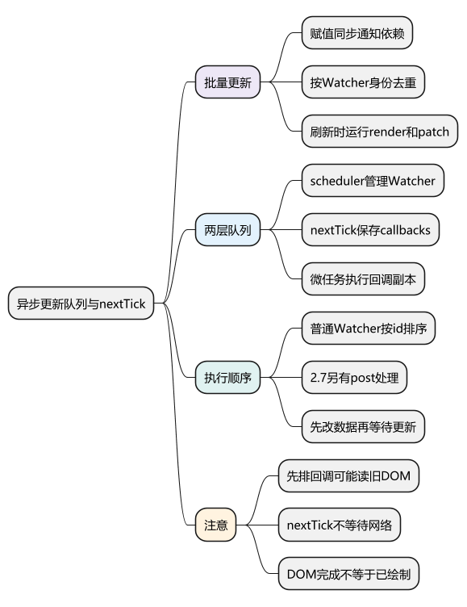
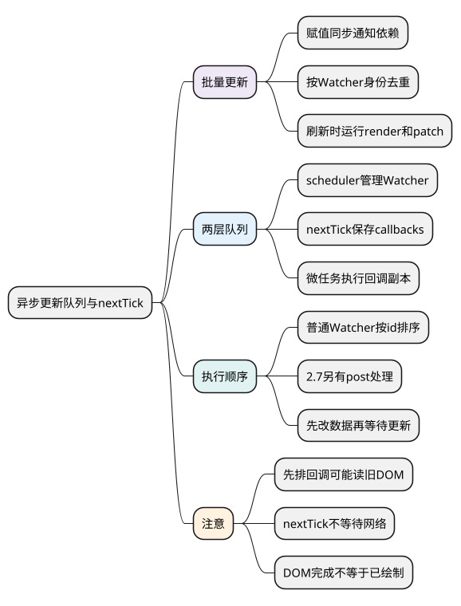
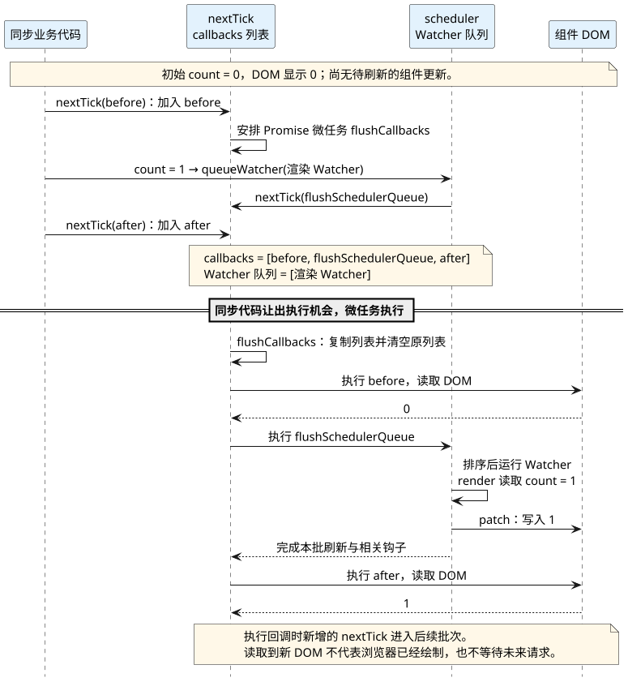

# 异步更新队列与 nextTick：合并渲染并等待 DOM 更新

<!-- core-mindmap:start -->
[](examples/v2s04-mindmap.svg)

<details>
<summary>PlantUML 源码</summary>



</details>

<!-- core-mindmap:end -->

**口述总览：** Vue 2 修改响应式数据后，会立即通知依赖，但普通组件渲染通常先进入队列。同一 Watcher 的多次同步通知会合并，随后按规则批量执行。nextTick 把回调加入另一层待执行列表；在数据修改后调用它，通常就能在本轮 Vue 更新之后读取 DOM。

源码基线：**Vue 2.7.16，浏览器环境、默认异步配置、原生 Promise 可用**。旧版降级分支会在后文说明；本篇不把浏览器、Node 和不同 Vue 版本的任务顺序混成一个结论。

## 观察批量更新：三次赋值只追加一次渲染

例子在浏览器中运行，`Vue` 是已加载的 Vue 2.7.16。使用 render，运行时构建即可。

<!-- example: v2s04-batched-render -->

```js
async function observeBatch() {
  let renders = 0
  const vm = new Vue({
    data: () => ({ count: 0 }),
    render(h) {
      renders++
      return h('p', String(this.count))
    }
  }).$mount()
  document.body.appendChild(vm.$el)

  vm.count = 1
  vm.count = 2
  vm.count = 3
  console.log(vm.count, vm.$el.textContent, renders) // 3 '0' 1

  await vm.$nextTick()
  console.log(vm.count, vm.$el.textContent, renders) // 3 '3' 2

  vm.$destroy()
  vm.$el.remove()
}
observeBatch()
```

数据的值已同步变成 3，DOM 暂时还是 0。异步的是默认渲染调度，不是 JavaScript 的赋值操作，也不是所有 Watcher 都要等待。

如果每次赋值之间都主动等待一轮更新，那么它们会变成多次渲染。这是执行时机变化后的自然结果，不与“同一批去重”矛盾。

## queueWatcher：按 Watcher 身份合并待执行工作

依赖变化后的主要链路是：

```text
响应式 setter / 数组变异
→ Dep.notify()
→ Watcher.update()
→ queueWatcher(watcher)
→ nextTick(flushSchedulerQueue)
→ flushSchedulerQueue()
→ watcher.run()
→ 渲染 Watcher 执行 render 和 patch
```

`queueWatcher` 用 Watcher 的 ID 记录它是否已经排队。同一组件在这批执行开始前连续被多个依赖通知，通常只保留一次待执行的渲染工作。

去重的单位是 Watcher，不是属性名、赋值语句或整个应用。不同组件、不同用户 Watcher 仍可能各有一份任务。

队列刷新期间允许继续加入工作，源码会根据当前执行位置插入新任务；已经执行过的 Watcher 在特定情况下也可能再次入队。不要把去重理解为“整个 tick 永远最多执行一次”。

## flushSchedulerQueue：为什么要排序

经典 Options 路径下，Watcher 通常按 ID 排序，ID 与创建顺序相关。父组件的渲染 Watcher 先于子组件创建，Options watch 又通常先于本组件渲染 Watcher 创建。

这有助于让父级先更新，让提前创建的用户侦听先处理，并使父更新过程中销毁的子组件不再执行无效渲染。

但“所有用户 watch 都先于 render”并不严谨：挂载后再调用 `$watch` 会产生更晚的 ID，2.7 的 Composition API 还存在 post 类型的排序处理。应按具体创建时机和选项分析。

一批渲染结束后，scheduler 再处理 activated、updated 等钩子。普通同步父子都参与本轮更新时，updated 钩子通常按子到父调用，不能把 Watcher 的执行排序等同于所有生命周期的调用排序。

## nextTick：Watcher 队列之外还有 callbacks 队列

这里至少要分清两层 Vue 自己维护的集合：

- **Watcher 队列**：保存要重新求值或渲染的 Watcher，由 `flushSchedulerQueue` 执行。
- **callbacks 列表**：保存 nextTick 回调，其中既可能有 scheduler 的刷新函数，也可能有用户回调，由 `flushCallbacks` 执行。

现代浏览器里，`timerFunc` 通过原生 Promise 把 `flushCallbacks` 安排到微任务。Vue 的这两个集合不是浏览器里新增的两种任务类型。

```text
queueWatcher 首次安排刷新
→ nextTick(flushSchedulerQueue)
→ callbacks 加入 scheduler 回调
→ 原生 Promise.then(flushCallbacks)
→ 同步代码继续
→ 微任务执行 callbacks 副本
→ scheduler 刷新 Watcher，再到后加入的用户回调
```

`flushCallbacks` 先取列表副本并清空原列表。回调执行过程中再次调用 nextTick，会进入后续批次，而不是无限追加到正在遍历的那份副本。

## 入队先后：先 nextTick 再改数据，回调可能读到旧 DOM

<!-- example: v2s04-callback-order -->

```js
async function observeOrder() {
  const seen = []
  const vm = new Vue({
    data: () => ({ count: 0 }),
    render(h) { return h('p', String(this.count)) }
  }).$mount()

  vm.$nextTick(() => seen.push(`before:${vm.$el.textContent}`))
  vm.count = 1
  vm.$nextTick(() => seen.push(`after:${vm.$el.textContent}`))

  await vm.$nextTick()
  console.log(seen.join(',')) // before:0,after:1
  vm.$destroy()
}
observeOrder()
```

这时 callbacks 的关键顺序是“第一个用户回调 → scheduler → 第二个用户回调”。nextTick 不会把所有用户回调强制移动到所有未来更新之后，所以可靠写法是先修改相关状态，再等待对应的 Vue 更新。

<!-- understanding-flow: v2s04-two-queues:start -->
<a id="v2s04-two-queues"></a>

对照上面的 `before:0,after:1`，分开看“回调列表里存了什么”和“真正渲染的 Watcher 存在哪里”。下面只画回调形式，省略例子最后用于收集结果的 await。

<details>
<summary>PlantUML 源码</summary>



</details>

<!-- understanding-flow: v2s04-two-queues:end -->

无回调的 `nextTick()` 返回 Promise，等待它后的继续执行还涉及 Promise 微任务调度。不能把上面回调形式的输出顺序原样套给所有 `.then` 或 await 写法。

## 微任务与降级：说明版本和环境，不背永远成立的口诀

2.7.16 的主要选择顺序是原生 Promise、满足条件的 MutationObserver、原生 setImmediate、最后 setTimeout。前两种通常进入微任务，后面的属于兼容环境中的降级选择。

因此说“现代浏览器中 Vue 2.7 的 nextTick 通常利用 Promise 微任务”比“nextTick 永远是微任务”准确。Vue 2 的更早版本也曾调整相关策略，查旧项目问题时应核对锁定版本。

浏览器是否绘制还取决于渲染机会。nextTick 后可以观察已完成的 DOM patch，但不等于用户已经看到新一帧，也不等于图片完成解码或 CSS 过渡已经结束。

`requestAnimationFrame` 是与渲染机会相关的回调，不应简单塞进“普通宏任务队列”来背顺序。精确的绘制和动画测量需要结合浏览器性能工具验证。

## 固定源码入口：从去重到实际执行

- [Watcher.update](https://github.com/vuejs/vue/blob/v2.7.16/src/core/observer/watcher.ts)：区分 lazy、sync 与普通入队。
- [queueWatcher 与 flushSchedulerQueue](https://github.com/vuejs/vue/blob/v2.7.16/src/core/observer/scheduler.ts)：看 ID 去重、排序、刷新期间插入和钩子处理。
- [nextTick 与 flushCallbacks](https://github.com/vuejs/vue/blob/v2.7.16/src/core/util/next-tick.ts)：看 callbacks 副本、pending 和 timerFunc。

建议先用例子打印 DOM 和渲染次数，再在 queueWatcher、flushSchedulerQueue、flushCallbacks 设断点。能够把两个队列串起来，比只记“异步更新使用微任务”更有用。

## 工程追问：nextTick 不能代替正确的数据与任务边界

展开折叠区域后读尺寸、切换表单后聚焦输入框，都适合先更新状态再 nextTick。如果等待的是接口数据，应先 await 请求，再等待由数据变更触发的 Vue 更新。

不要在 updated 里无条件改动自身渲染依赖，也不要在 watch 回调里反复修改互相依赖的字段。这可能导致再次入队甚至更新循环；增加 nextTick 只会改变循环的时机。

大量同步计算会阻塞事件循环，即使渲染工作已排队，微任务也必须等当前代码让出执行机会。nextTick 不是后台线程，不会自动把昂贵计算移走。

<a id="interview"></a>

## 试题

<a id="v2s04-01"></a>

### V2S04-01 [P0·原理] 连续修改三次数据，为什么通常只更新一次 DOM？

**回答：** 每次修改都可能通知依赖，但普通渲染 Watcher 经 queueWatcher 入队，同一批执行前会按 Watcher ID 去重。同步代码结束后，scheduler 再运行它，render 读到最终数据并 patch DOM。因此是多次通知合并为一次待执行渲染，不是只保留最后一次赋值。

<a id="v2s04-02"></a>

### V2S04-02 [P1·源码] Watcher 队列与 nextTick 的 callbacks 有什么关系？

**回答：** Watcher 队列保存实际待运行的订阅者，由 flushSchedulerQueue 刷新；nextTick 的 callbacks 保存回调，scheduler 的刷新函数也是其中一个回调。现代浏览器用 Promise 微任务执行 flushCallbacks，再由它调用 scheduler 和用户回调。两者是 Vue 内部不同层次的集合，不能混成一个队列。

<a id="v2s04-03"></a>

### V2S04-03 [P0·原理] nextTick 是否总能拿到最新 DOM？

**回答：** 应在相关响应式数据修改之后调用，等待这次 Vue 更新完成。如果用户回调先于更新刷新函数入队，可能读到旧 DOM；之后发生的异步请求或状态变化也不在本次等待范围内。nextTick 保证的不是任意未来状态，也不是浏览器已经绘制或资源已加载。

<a id="v2s04-04"></a>

### V2S04-04 [P1·场景] nextTick 后页面还是卡，应该怎么排查？

**回答：** nextTick 只协调更新时机，不减少数据量或把计算移到后台。应测量同步计算、render、patch、布局和绘制各段耗时，检查大列表、深度侦听和重复更新，再选择减少依赖、分页或虚拟列表、拆分计算等方案。网络或图片造成的延迟也要单独观察，不能用更多 nextTick 掩盖。
