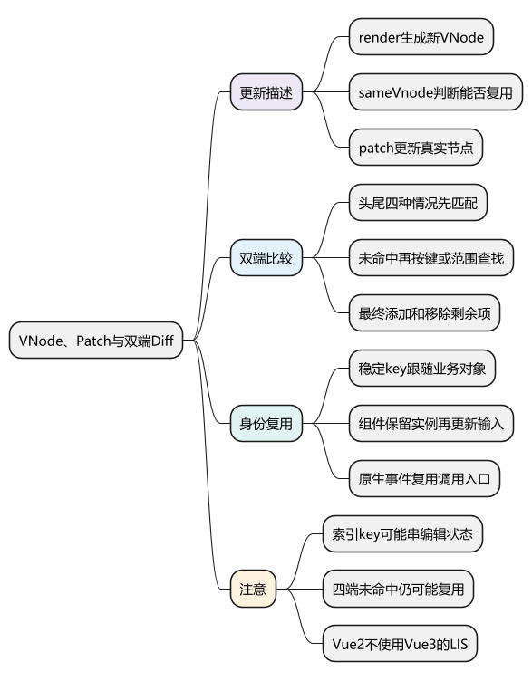
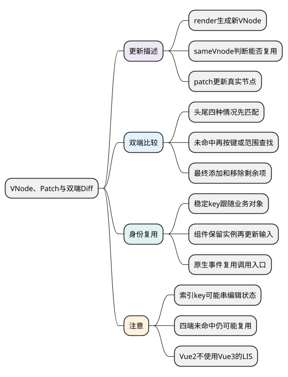
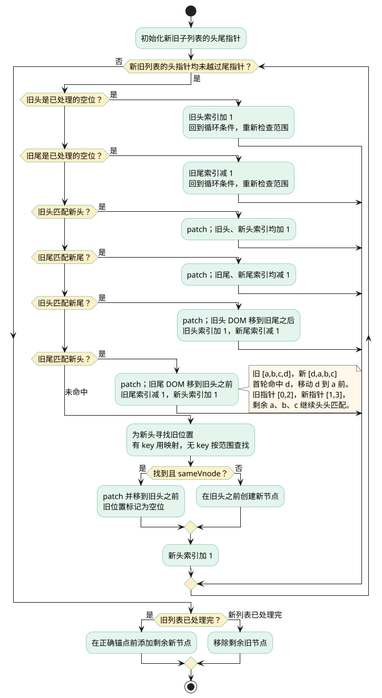

# VNode、Patch 与双端 Diff：复用节点并更新差异

<!-- core-mindmap:start -->
[](examples/v2s05-mindmap.svg)

<details>
<summary>PlantUML 源码</summary>



</details>

<!-- core-mindmap:end -->

**口述总览：** VNode 用 JavaScript 对象描述页面。组件重新渲染后得到新 VNode，patch 比较新旧描述，决定复用、更新、移动还是删除真实节点。Vue 2 的子节点比较采用双端算法，优先比较新旧列表两端，无法命中时再查找可复用节点。key 用来表达同级节点身份，不是一个自动提高所有性能的开关。

源码基线：**Vue 2.7.16 浏览器端 patch**。本篇讨论 Vue 2 的双端 Diff，不使用 Vue 3 的最长递增子序列流程来解释它。

## 观察节点身份：改变顺序可以移动原节点

下面例子在已加载 Vue 2.7.16 的浏览器运行。它比较 DOM 对象身份，而不只是比较最终文字。

<!-- example: v2s05-keyed-reuse -->

```js
async function observeReuse() {
  const vm = new Vue({
    data: () => ({ ids: ['a', 'b', 'c'] }),
    render(h) {
      return h('ul', this.ids.map(id => h('li', { key: id }, id)))
    }
  }).$mount()
  const original = new Map(
    Array.from(vm.$el.children, node => [node.textContent, node])
  )

  vm.ids = ['c', 'a', 'b']
  await vm.$nextTick()
  console.log(Array.from(vm.$el.children, node => node.textContent).join(','))
  // c,a,b
  console.log(Array.from(vm.$el.children).every(
    node => original.get(node.textContent) === node
  )) // true：原来的 li 被复用

  vm.$destroy()
}
observeReuse()
```

这证明一次重排不一定要销毁并重建全部节点；但它没有证明虚拟 DOM 比所有手写 DOM 操作都快。虚拟 DOM 自己也要创建对象和比较，收益需要放在具体更新方式与维护成本中评估。

## VNode：保存描述，也关联已有 DOM 和组件实例

VNode 常见信息包括标签、key、data、children、文本，以及关联的 DOM `elm`。组件 VNode 还携带组件构造信息，创建后可关联到 `componentInstance`。

```text
模板编译得到 render
→ 执行 render 得到 VNode
→ patch 创建或更新真实 DOM
```

模板编译输出的是渲染函数代码，不是直接得到一份会随数据自动改变的 VNode。动态 VNode 要在 render 执行时根据当前数据产生。

VNode 也不是简单复制浏览器 DOM 的所有字段。它保留渲染器需要的描述，平台相关的创建、插入、删除操作由 nodeOps 和模块钩子完成。

## patch：先判断整体能否复用，再处理内部差异

`_update` 将旧 VNode 和新 VNode 交给平台 patch。首次挂载可能拿到真实挂载点或空旧节点；后续更新通常对比前后两棵 VNode 树。

```text
patch(oldVnode, vnode)
├─ 新节点不存在：进入销毁处理
├─ 首次创建：createElm
├─ 新旧可复用：patchVnode
└─ 新旧不可复用：创建新节点并移除旧节点
```

`sameVnode` 会结合 key、标签、注释状态、data 情况等判断，输入元素类型和异步组件还有专门分支。同 key 并不意味着任何不同类型的节点都能复用。

进入 `patchVnode` 后，需要更新属性、样式、事件等模块，再比较文本和 children。新旧都有子列表时进入 `updateChildren`；只有新列表就添加，只有旧列表就移除，不能把所有情况都写成“继续比较子列表”。

## 双端比较：用四种命中减少查找

对新旧子数组分别维护开始和结束位置。跳过已处理位置后，依次尝试：

- 旧头对新头：复用并更新，两边的头向后移动。
- 旧尾对新尾：复用并更新，两边的尾向前移动。
- 旧头对新尾：更新后，把旧头对应 DOM 移到旧尾之后。
- 旧尾对新头：更新后，把旧尾对应 DOM 移到旧头之前。

```text
旧列表：[a, b, c, d]
新列表：[d, a, b, c]

旧尾 d 命中新头 d
→ patch d
→ 把 d 的 DOM 移到 a 前面
→ 剩余 [a, b, c] 继续比较
```

移动通常通过 `insertBefore` 完成。对已经存在于 DOM 中的节点进行插入会移动它的位置，不必先复制一个同内容节点。

四种情况都不命中，**不代表已经没有可复用节点**。有 key 时按需建立旧节点 key 到索引的映射，寻找新头对应的旧节点；无 key 时可能在线性范围内查找满足 `sameVnode` 的节点。

找到且满足复用条件就 patch、移动并标记旧位置已处理；找不到或类型不兼容则创建。一个列表先处理完后，剩余新节点需要添加，剩余旧节点需要移除。

不能把该算法背成任意输入都严格线性、保证全局最少 DOM 操作。它采用同级比较和常见重排优化；无 key 查找等路径也有不同成本。

<!-- understanding-flow: v2s05-double-ended-diff:start -->
<a id="v2s05-double-ended-diff"></a>

把四个指针放进同一轮判断，便于对应 `updateChildren` 的分支。图中“匹配”指 `sameVnode`，不只是 key 相等；按普通允许移动的列表更新绘制，不展开过渡组件的 `removeOnly` 分支。

<details>
<summary>PlantUML 源码</summary>



</details>

<!-- understanding-flow: v2s05-double-ended-diff:end -->

## key：保护业务身份，而不仅是最终文字

用数组索引作 key 时，索引代表“当前位置”。插入、删除或排序后，同位置可能已经换了业务对象，但 Vue 仍可能复用原组件实例及其内部状态。

<!-- example: v2s05-index-key-state -->

```js
async function observeIndexKey() {
  const Row = {
    props: ['item'],
    data() { return { draft: this.item.id } },
    render(h) { return h('li', `${this.item.id}:${this.draft}`) }
  }
  const vm = new Vue({
    data: () => ({ items: [{ id: 'a' }, { id: 'b' }] }),
    render(h) {
      return h('ul', this.items.map((item, index) =>
        h(Row, { key: index, props: { item } })
      ))
    }
  }).$mount()

  vm.items.reverse()
  await vm.$nextTick()
  console.log(Array.from(vm.$el.children, node => node.textContent).join(','))
  // b:a,a:b：props 已交换，按位置复用的实例仍保留旧 draft

  vm.$destroy()
}
observeIndexKey()
```

把 key 改为 `item.id`，重新运行会得到 `b:b,a:a`。这里 draft 故意表示组件的独立编辑状态，不应简单通过每次覆盖 draft 来掩盖身份选择错误。

key 应在同级列表中唯一、稳定且与业务身份对应。随机 key 会使每次渲染都像新节点，破坏复用；重复 key 会造成匹配歧义；确实需要重建组件时，改变 key 才是明确的重置手段。

## 组件与事件：复用实例不等于跳过更新

组件 VNode 能复用时，`prepatch` 会把原 `componentInstance` 交给新 VNode，并通过 `updateChildComponent` 更新 props、父监听器和插槽等信息。子组件是否继续更新，要看依赖和相关强制更新条件。

普通 DOM 事件由浏览器平台 events 模块处理，更新时可复用事件 invoker 并替换其函数列表，避免对所有事件都重复移除与注册。

组件自定义事件则由组件事件系统管理，不能把 `@save` 直接当作浏览器原生冒泡事件。Vue 2 的 `.native` 监听组件根 DOM，也与组件 `$emit` 的事件路径不同。

## 固定源码入口：先看四个核心函数

- [patch、sameVnode、patchVnode、updateChildren](https://github.com/vuejs/vue/blob/v2.7.16/src/core/vdom/patch.ts)：重点跟踪新旧头尾指针与 DOM 移动。
- [VNode 定义](https://github.com/vuejs/vue/blob/v2.7.16/src/core/vdom/vnode.ts)：确认描述字段与实例关联。
- [组件创建与 prepatch](https://github.com/vuejs/vue/blob/v2.7.16/src/core/vdom/create-component.ts)：看组件身份复用。
- [浏览器原生事件模块](https://github.com/vuejs/vue/blob/v2.7.16/src/platforms/web/runtime/modules/events.ts)：区分 DOM 监听与组件事件。
- [事件监听更新工具](https://github.com/vuejs/vue/blob/v2.7.16/src/core/vdom/helpers/update-listeners.ts)：看 invoker 的复用。

## 工程追问：列表错位与性能应该分别验证

编辑状态错位、输入框焦点异常或组件 mounted 反复触发，先检查 key 和组件身份。正确性稳定之后，再测量数据规模、render 次数、patch 耗时与布局开销。

即使 key 完全正确，几万项列表仍需要生成与比较大量节点。分页、虚拟列表和减少每项的渲染成本，通常比单纯背 Diff 更能解决实际问题。

<a id="interview"></a>

## 试题

<a id="v2s05-01"></a>

### V2S05-01 [P0·原理] Vue 2 的 VNode、patch 和 Diff 分别是什么？

**回答：** VNode 是页面结构和组件的 JavaScript 描述；patch 根据新旧 VNode 创建、复用、移动或删除真实节点；Diff 指其中比较差异并选择更新操作的过程。render 每次产生新的描述，patch 尽量复用兼容节点，但不保证比所有手写 DOM 都快，也不保证任意场景下操作数全局最少。

<a id="v2s05-02"></a>

### V2S05-02 [P1·源码] Vue 2 双端 Diff 的主要过程是什么？

**回答：** 新旧子列表各维护头尾位置，依次尝试头头、尾尾、旧头新尾、旧尾新头匹配，命中就更新并在需要时移动 DOM。都不命中时，使用 key 映射或无 key 的范围查找寻找可复用节点，否则创建。结束后添加剩余新节点或删除剩余旧节点。这是 Vue 2 的流程，不能换成 Vue 3 的最长递增子序列解释。

<a id="v2s05-03"></a>

### V2S05-03 [P0·原理] 为什么可重排的有状态列表不宜使用索引作为 key？

**回答：** 索引描述位置，排序后同一位置可能换了业务对象，Vue 却复用原组件实例，于是新的 props 与旧编辑状态、焦点或第三方控件状态混在一起。稳定业务 ID 让实例跟随业务对象移动；随机或重复 key 也不能解决问题。纯静态无状态列表的风险不同，但不能据此推广到可编辑列表。

<a id="v2s05-04"></a>

### V2S05-04 [P1·场景] key 没变、组件被复用，为什么子组件仍会更新？

**回答：** 复用表示保留实例身份，不表示保留所有旧输入。组件 prepatch 会更新 props、父监听器和插槽信息；响应式 props 变化可能通知子渲染 Watcher，插槽等情况还可能要求强制更新。应区分重新创建实例、重新执行 render 和实际 DOM 改动，它们是不同层次的工作。
