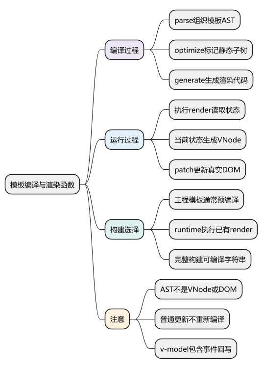
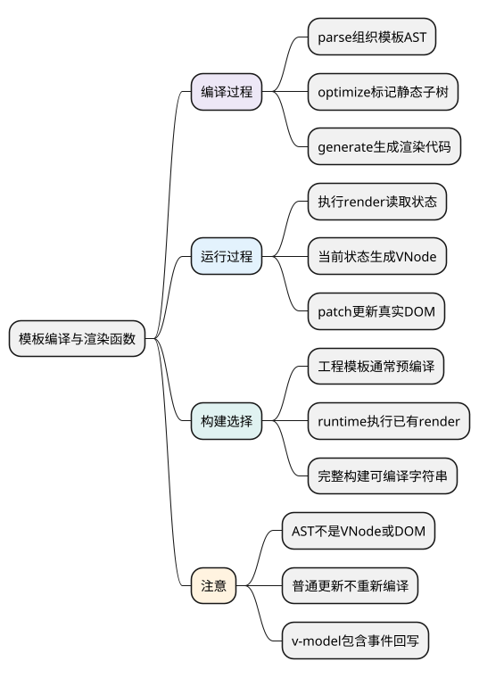
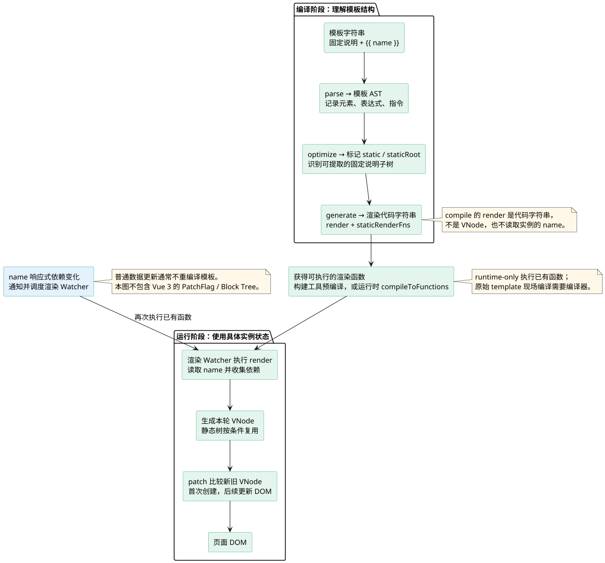

# 模板编译与渲染函数：把声明式模板变成可执行描述

<!-- core-mindmap:start -->
[](examples/v2s06-mindmap.svg)

<details>
<summary>PlantUML 源码</summary>



</details>

<!-- core-mindmap:end -->

**口述总览：** Vue 2 的模板编译分为解析、优化和代码生成：先把模板解析成语法树，再标记可复用的静态部分，最后生成 render 和静态渲染函数。运行 render 才会得到 VNode，patch 再更新 DOM。工程中通常提前编译模板，因此浏览器使用不带编译器的运行时也能渲染 `.vue` 组件。

源码基线：**Vue 2.7.16 的 Web 编译器**。本篇学习模板如何连接运行时，不要求背解析器的每个正则，也不把 Vue 3 的 PatchFlag、Block Tree 写成 Vue 2 的能力。

## 观察编译结果：模板先变为代码，不是直接变为 DOM

以下例子在 Node 环境执行，需要 `vue-template-compiler@2.7.16`。本系列验证环境同时安装相同版本 Vue；维护旧工程时也应先核对运行时和编译链版本是否兼容。

<!-- example: v2s06-compile-output -->

```js
const compiler = require('vue-template-compiler')
const template = `
  <section>
    <div><h2>固定标题</h2><p>帮助信息</p></div>
    <p>{{ name }}</p>
  </section>
`
const result = compiler.compile(template)

console.log(result.errors.length) // 0
console.log(result.ast.tag) // section
console.log(typeof result.render) // string：此处是函数体代码
console.log(result.staticRenderFns.length) // 1：提取了静态子树
console.log(result.render.includes('_m(0)')) // true
console.log(result.ast.children[0].staticRoot) // true
```

这个例子没有传入 name，也没有创建浏览器节点。编译器只需要模板及编译选项，负责生成“将来如何读取 name 并创建 VNode”的代码。

编译结果里出现 `_c`、`_v`、`_s`、`_m` 等辅助调用是正常的：它们分别涉及创建节点、创建文本、值转字符串和静态树处理，不是四种新的业务 API。

## parse：将标签、属性与指令组织成 AST

AST 是抽象语法树，用对象关系表达模板中的元素、文本、表达式和指令。它描述的是模板结构，不是浏览器真实 DOM，也不是运行时 VNode。

```text
<p v-if="visible">{{ name }}</p>
→ 元素 p
→ 条件表达式 visible
→ 文本插值表达式 name
```

解析过程中会识别标签的开始结束、属性和文本，并处理 `v-if`、`v-for`、事件、绑定等信息，让后续代码生成知道哪些部分需要条件、循环或事件处理函数。

模板的表达式并非任意独立 JavaScript 文件。像赋值语句位置、插值表达式、指令使用范围和单根要求，都要遵守 Vue 2 模板规则。

错误模板不能简单靠浏览器“帮忙修复”后就认定安全可用。应在开发编译时检查错误与警告，并确认构建链实际使用的模板内容。

## optimize：标记静态节点与值得提取的静态子树

静态部分不依赖每次变化的状态。优化器会分析节点是否静态，并进一步判断是否值得作为静态根提取。

例如一个包含固定标题和固定说明的 div，可以从动态 render 中提取；仅有一段简单静态文本的节点不一定值得额外函数调用和缓存开销，所以“静态节点”与“静态根”不是同义词。

```text
动态页面
├─ 固定说明区域：可提取为静态渲染函数
└─ 用户名称区域：根据当前 name 重新生成
```

运行时通过静态树辅助入口复用合适的结果，patch 也有静态节点快捷路径。但循环内静态节点等情况还有额外限制，不能把一份 VNode 随意塞到多个位置复用。

静态优化是减少重复工作，不是声明“这个组件永远不更新”。父级状态变化、指令行为和动态子树仍需各自处理。

## generate：把模板行为转成渲染代码

代码生成会把 AST 中的信息映射成函数体，例如：

- 插值表达式转换成取值与文本 VNode。
- `v-if` 转成条件选择。
- `v-for` 转成列表渲染调用。
- 属性、样式、DOM 属性和事件分别写入 VNode data 的对应位置。
- 静态根通过静态渲染函数入口引用。

```text
baseCompile(template, options)
→ parse(template, options)
→ optimize(ast, options)
→ generate(ast, options)
→ { ast, render, staticRenderFns }
```

`compile` 产生的 render 通常还是代码字符串；`compileToFunctions` 会继续生成可调用的函数并缓存对应结果。构建工具还可能采用额外处理来生成适合模块环境的产物，不能把调试输出的 `with(this)` 函数体直接当成任意 ESM 文件执行。

## render：执行时读取状态，形成响应式依赖

模板编译通常不用读取某个具体组件实例的当前数据。真正执行 render 时，才会访问组件状态，触发响应式 getter，得到本轮 VNode。

```text
编译阶段：模板 → render 代码
运行阶段：render + 当前状态 → VNode
更新阶段：新旧 VNode → patch → DOM
```

这也是为什么普通数据更新通常重新执行 render，而不必重新解析整份模板。模板和编译选项没变，就没有理由因一次 count 增加再跑一次完整编译器。

编译优化与运行时依赖收集相互配合，但职责不同。不要把“编译器看到插值”说成“编译器已经替组件收集了所有响应式 Watcher”。

<!-- understanding-flow: v2s06-compile-render:start -->
<a id="v2s06-compile-render"></a>

沿本篇“固定说明区域 + 动态 name”的模板追踪产物：AST、渲染代码、VNode 和 DOM 分属不同阶段。数据变化的回路回到 render，不回到 parse。

<details>
<summary>PlantUML 源码</summary>



</details>

<!-- understanding-flow: v2s06-compile-render:end -->

## v-model：说明数据流由绑定与事件共同完成

对普通文本输入框，可以先把 v-model 理解为值绑定加输入事件回写。以下是帮助观察数据流的手写 render，不包含输入法、修饰符、复选框等完整编译分支。

浏览器中已加载 Vue 2.7.16 时可运行：

<!-- example: v2s06-model-dataflow -->

```js
async function observeModel() {
  const vm = new Vue({
    data: () => ({ text: 'A' }),
    render(h) {
      return h('input', {
        domProps: { value: this.text },
        on: { input: event => { this.text = event.target.value } }
      })
    }
  }).$mount()

  vm.$el.value = 'B'
  vm.$el.dispatchEvent(new Event('input', { bubbles: true }))
  console.log(vm.text) // B：事件处理函数把输入写回状态

  vm.text = 'C'
  await vm.$nextTick()
  console.log(vm.$el.value) // C：状态通过渲染写到输入框
  vm.$destroy()
}
observeModel()
```

响应式系统负责状态变化后通知更新，表单事件负责把用户输入写回状态。不能把 getter/setter 自身说成“自动完成所有双向绑定”。

Vue 2 组件的 v-model 默认使用 value prop 与 input 事件，也可以通过 model 选项定制；它与原生 input 的 DOM 属性和事件处理不是同一段实现。

## 运行时构建与完整构建：先确认模板在哪里编译

只有运行时的构建可以创建实例、执行 render、维护响应式和 patch，但不能在浏览器里把未经处理的 template 字符串编译成 render。

完整构建包含编译器。其 `$mount` 扩展会在缺少 render 时尝试从 template 或挂载元素取得模板，再调用编译入口。已有 render 时无需经过这段编译。

单文件组件通常由构建工具提前编译 template、处理 script 和 style。Vue 2.7 工程还应根据实际 loader/plugin 检查它使用的 SFC 编译入口，不要仅凭教程中出现某个包名就盲目增删依赖。

运行时模板会生成并执行代码，不能把不可信的用户输入直接当模板编译。动态业务内容优先作为数据传入受控组件；服务端权限校验也不能交给模板表达式承担。

## 固定源码入口：从平台入口到三段核心过程

- [Web 的编译挂载入口](https://github.com/vuejs/vue/blob/v2.7.16/src/platforms/web/runtime-with-compiler.ts)：看什么时候读取 template。
- [baseCompile](https://github.com/vuejs/vue/blob/v2.7.16/src/compiler/index.ts)：连接 parse、optimize、generate。
- [模板解析](https://github.com/vuejs/vue/blob/v2.7.16/src/compiler/parser/index.ts)：看标签、指令和表达式处理。
- [静态优化](https://github.com/vuejs/vue/blob/v2.7.16/src/compiler/optimizer.ts)：看 static 与 staticRoot。
- [代码生成](https://github.com/vuejs/vue/blob/v2.7.16/src/compiler/codegen/index.ts)：看 render 和静态函数代码。
- [生成可调用函数](https://github.com/vuejs/vue/blob/v2.7.16/src/compiler/to-function.ts)：区分代码字符串与函数。
- [Web 的 v-model 编译](https://github.com/vuejs/vue/blob/v2.7.16/src/platforms/web/compiler/directives/model.ts)：按表单类型阅读不同分支。

## 工程追问：构建错误、渲染错误和更新错误要分开定位

模板编译失败，先看语法和构建版本；运行时提示没有编译器，检查是否把原始 template 交给 runtime-only；页面能渲染但不更新，再检查状态读取和响应式通知。

性能问题也要分阶段测量：首屏模板编译成本、每次 render 成本、patch 成本和浏览器布局绘制不是同一项。工程预编译可以减少浏览器编译工作，但不会自动消除大列表和重计算。

<a id="interview"></a>

## 试题

<a id="v2s06-01"></a>

### V2S06-01 [P0·原理] Vue 2 模板编译的三个核心阶段是什么？

**回答：** parse 把模板解析成 AST，记录元素、文本、表达式和指令；optimize 分析静态节点与静态根；generate 产生 render 和 staticRenderFns 的代码。运行时执行 render 才得到 VNode，再由 patch 操作 DOM。编译输出、VNode 和真实 DOM 是三个不同层次。

<a id="v2s06-02"></a>

### V2S06-02 [P1·源码] 静态节点为什么不一定都提取成静态渲染函数？

**回答：** 提取与缓存也有调用和维护成本。一个只有简单文本的静态节点，重复创建可能比额外函数入口更划算；优化器还要判断它是否适合作为静态根。循环内等场景另有处理，不能把静态标记理解为任意位置共享同一 VNode，也不能套用 Vue 3 的 PatchFlag 流程。

<a id="v2s06-03"></a>

### V2S06-03 [P0·原理] v-model 和响应式系统是什么关系？

**回答：** 响应式系统负责状态变化后通知渲染；v-model 还需要值绑定和事件回写，把用户操作同步到状态。普通文本框可理解为 value 绑定加 input 回写，完整实现还处理输入法、修饰符和不同表单类型。组件 v-model 则通过 prop 与自定义事件约定完成，不能只用 defineProperty 解释全部双向数据流。

<a id="v2s06-04"></a>

### V2S06-04 [P1·场景] 改一个数据，Vue 会重新编译模板吗？

**回答：** 通常不会。模板已编译成 render，数据变化触发渲染 Watcher 再执行 render，产生新 VNode 并 patch。应区分模板发生变化需要重新编译，与现有模板读取不同状态需要重新渲染。排查性能时也应分别测量编译、render、patch 和浏览器渲染成本。
