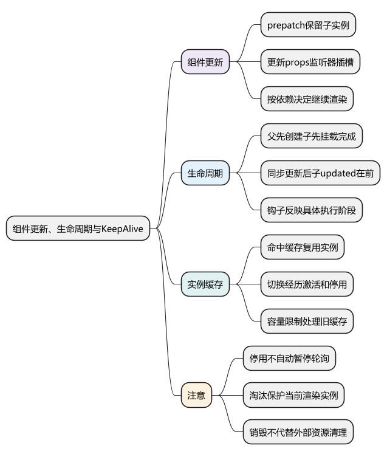
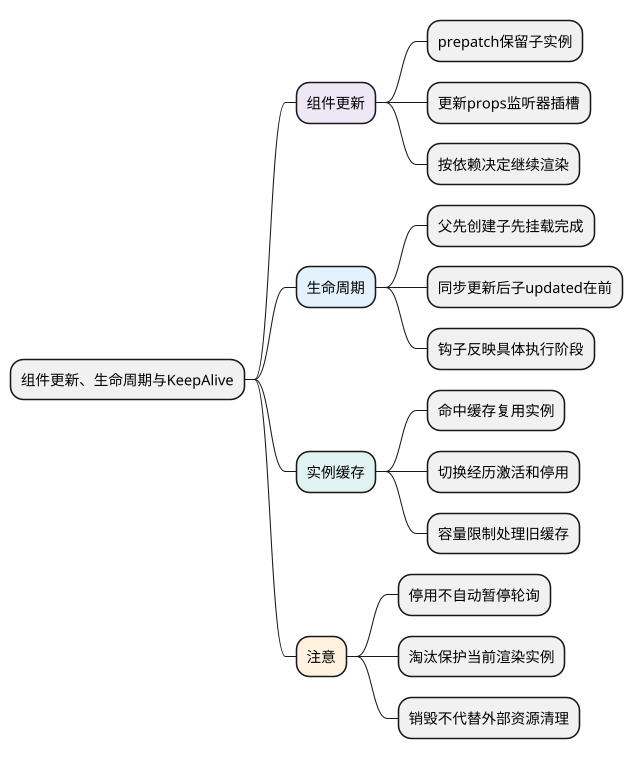
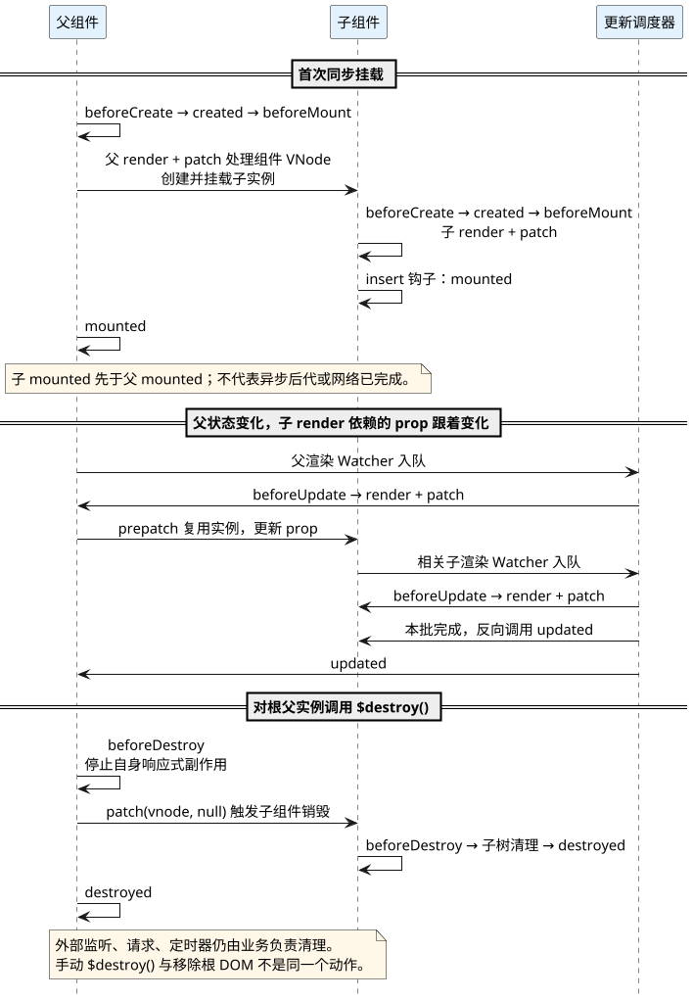
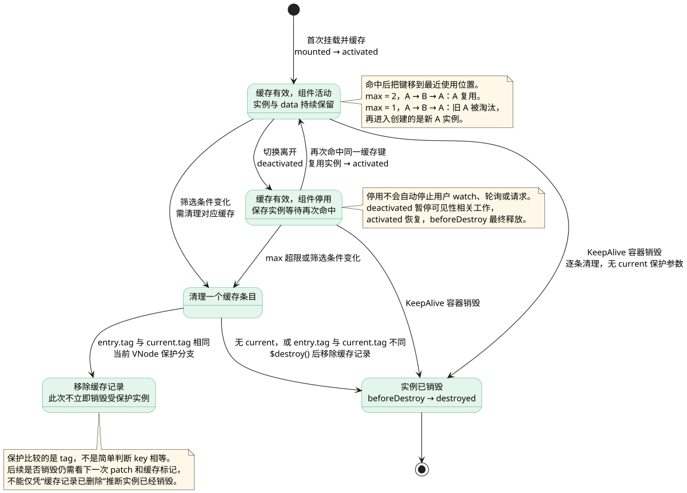

# 组件更新、生命周期与 KeepAlive：区分复用、停用和销毁

<!-- core-mindmap:start -->
[](examples/v2s07-mindmap.svg)

<details>
<summary>PlantUML 源码</summary>



</details>

<!-- core-mindmap:end -->

**口述总览：** 父组件更新会产生新的组件 VNode，能复用时保留原子实例，再更新它的 props、监听器和插槽。生命周期是这些创建、更新、插入和销毁动作的观察点。KeepAlive 进一步缓存组件实例，使切换时进入停用而不是立即销毁；缓存淘汰与真正销毁时，仍要按资源的归属做清理。

源码基线：**Vue 2.7.16，浏览器端普通有状态组件**。先观察同步父子组件，再看 KeepAlive；异步组件、服务端渲染和过渡动画的时机要单独分析。

## 观察父子顺序：创建从父到子，挂载完成从子到父

在已加载 Vue 2.7.16 的浏览器执行。例子只在父值变化且子 render 确实读取该 prop 的情况下比较更新顺序。

<!-- example: v2s07-lifecycle-order -->

```js
async function observeLifecycle() {
  const events = []
  const names = [
    'beforeCreate', 'created', 'beforeMount', 'mounted',
    'beforeUpdate', 'updated', 'beforeDestroy', 'destroyed'
  ]
  const hooks = label => Object.fromEntries(names.map(name => [
    name, function () { events.push(`${label}:${name}`) }
  ]))
  const Child = {
    ...hooks('child'),
    props: ['value'],
    render(h) { return h('span', String(this.value)) }
  }
  const vm = new Vue({
    ...hooks('parent'),
    data: () => ({ count: 0 }),
    render(h) { return h('div', [h(Child, { props: { value: this.count } })]) }
  }).$mount()

  console.log(events.join(','))
  // parent:beforeCreate,parent:created,parent:beforeMount,
  // child:beforeCreate,child:created,child:beforeMount,child:mounted,parent:mounted

  events.length = 0
  vm.count++
  await vm.$nextTick()
  console.log(events.join(','))
  // parent:beforeUpdate,child:beforeUpdate,child:updated,parent:updated

  events.length = 0
  vm.$destroy()
  console.log(events.join(','))
  // parent:beforeDestroy,child:beforeDestroy,child:destroyed,parent:destroyed
}
observeLifecycle()
```

这些输出有明确条件：父子是同步组件，子组件在本轮确实更新，没有插入额外异步任务。父组件更新不代表所有后代都必然重新渲染，也不能从父 mounted 推断异步子组件和外部请求全部完成。

## 组件复用：prepatch 更新输入，保留实例身份

父 render 生成的新组件 VNode，与旧 VNode 满足复用条件时，组件内部 `prepatch` 钩子把旧 `componentInstance` 交给新 VNode，再调用 `updateChildComponent`。

```text
父状态变化
→ 父渲染 Watcher 执行 render
→ 新旧组件 VNode 匹配
→ prepatch 复用子实例
→ updateChildComponent 更新输入
→ props、插槽等触发需要的子组件更新
```

普通 prop 更新不需要重新执行子组件 data，也不会再次触发 created 或 mounted。如果看到它们反复执行，应检查 key、组件类型和条件分支是否使实例身份变化。

子 props 发生响应式变化，只有相关依赖被使用时才有对应通知；旧式插槽、动态作用域插槽等场景也可能需要 `$forceUpdate`。所以不能简化成“父 render 后无条件递归 render 所有子组件”。

父组件传入的自定义事件会经 `updateComponentListeners` 更新到子事件系统。监听函数虽由父级提供，子组件 `$emit` 时会在其事件中心触发相应回调；这不是 DOM 的捕获和冒泡机制。

## 生命周期：每个钩子对应具体阶段

- `beforeCreate/created`：实例状态准备前后；不是 DOM 创建前后。
- `beforeMount/mounted`：首次渲染和插入相关阶段；不是网络资源全部完成。
- `beforeUpdate/updated`：已挂载实例参与一次更新前后；不是每次赋值各触发一次。
- `beforeDestroy/destroyed`：实例开始与完成销毁；不是业务全部外部资源自动消失。

更新队列通常先处理父渲染 Watcher，再处理子渲染 Watcher；一批完成后，scheduler 反向处理相关 updated 钩子，因此常见同步父子场景是子 updated 先于父 updated。

不要在 updated 内无条件改变自身渲染依赖。它会引入新的更新，甚至形成循环。需要观察具体状态时，使用范围明确的 watch，DOM 读取再结合更新时机处理。

<!-- understanding-flow: v2s07-parent-child-hooks:start -->
<a id="v2s07-parent-child-hooks"></a>

把上面日志放到父、子两条线上，可以看出“先执行 render”和“先调用完成钩子”并不是同一个顺序。图限定普通同步父子组件，两者本轮都更新，销毁部分不含 KeepAlive 缓存分支。

<details>
<summary>PlantUML 源码</summary>



</details>

<!-- understanding-flow: v2s07-parent-child-hooks:end -->

## KeepAlive：缓存的是实例，不是简单保存 HTML 字符串

KeepAlive 是抽象组件，主要管理它包裹的组件 VNode。缓存命中时，把缓存的 `componentInstance` 复用到本次 VNode，并设置 keepAlive 标记。

```text
首次出现 → 正常创建实例 → 缓存实例
切换离开 → 组件停用 → deactivated
再次命中 → 复用原实例 → activated
缓存淘汰 / 缓存容器销毁 → 按销毁流程处理实例
```

普通缓存切换会保留 data 和实例身份，因此返回时一般不会再次执行 created、mounted。首次挂载的缓存组件也会触发 activated，不是只有第二次进入才触发。

停用不意味着 `$destroy`，也不意味着所有用户侦听、定时器、网络订阅自动暂停。是否应该继续工作，需要根据页面是否可见和资源用途决定。

## max：用可观察例子区分缓存命中与淘汰

<!-- example: v2s07-keepalive-capacity -->

```js
async function observeCache(max) {
  const created = { A: 0, B: 0 }
  const destroyed = { A: 0, B: 0 }
  const panels = Object.fromEntries(['A', 'B'].map(name => [name, {
    name: `Panel${name}`,
    created() { created[name]++ },
    destroyed() { destroyed[name]++ },
    render(h) { return h('p', name) }
  }]))
  const vm = new Vue({
    data: () => ({ current: 'A' }),
    render(h) {
      return h('keep-alive', { props: { max } }, [
        h(panels[this.current], { key: this.current })
      ])
    }
  }).$mount()

  vm.current = 'B'
  await vm.$nextTick()
  vm.current = 'A'
  await vm.$nextTick()
  console.log(JSON.stringify({ max, created, destroyed }))
  vm.$destroy()
}

async function runCacheExamples() {
  await observeCache(2)
  // {"max":2,"created":{"A":1,"B":1},"destroyed":{"A":0,"B":0}}
  await observeCache(1)
  // {"max":1,"created":{"A":2,"B":1},"destroyed":{"A":1,"B":1}}
}
runCacheExamples()
```

输出发生在销毁根实例之前，因此计数体现的是切换期间的缓存行为。max 为 2 时能保留两个实例；max 为 1 时切换会淘汰旧缓存，再返回 A 就需要创建新实例。

## 缓存键与淘汰：理解 LRU 思路和当前实例保护

显式 key 存在时，KeepAlive 用它定位缓存；没有 key 时，按组件构造标识和标签等生成默认键。相同组件类型的不同业务页面是否应共享一个实例，要通过 key 策略表达。

缓存命中会把键移到记录队列末尾，超过 max 时处理最久未使用的条目，这是常说的 LRU 思路。源码缓存条目包含实例等信息，不只是最后一次 HTML。

`include/exclude` 根据组件名称筛选缓存，`max` 限制数量。缓存清理通过 `pruneCacheEntry` 进行，并对当前正在渲染的组件有保护：2.7.16 会比较当前 VNode 与缓存条目的 tag，不能笼统断言“删缓存条目就立即销毁当前活动实例”。

页面 key 不宜无界增长，例如每次进入都生成时间戳。缓存容量需要与实际页面状态大小、外部资源和内存观测一起设计。

<!-- understanding-flow: v2s07-keepalive-states:start -->
<a id="v2s07-keepalive-states"></a>

跟踪单个缓存实例的状态，重点看“停用后还能回来”和“真正销毁后必须重建”。下面的淘汰分支保留当前 VNode 的保护条件，避免把所有缓存清理都画成立即销毁。

<details>
<summary>PlantUML 源码</summary>



</details>

<!-- understanding-flow: v2s07-keepalive-states:end -->

## $destroy：停止实例关系和订阅，外部资源仍需释放

Vue 2.7 的 `$destroy` 会触发 beforeDestroy，解除适用的父子关系，停止组件作用域中的响应式效果，执行 VNode 的销毁处理，随后触发 destroyed 并清理实例事件等。

单独调用 `vm.$destroy()` **不等于把当前根 DOM 自动从 document 移除**。由父组件 patch 移除子树与手工销毁实例是不同的操作路径；手工挂载的实例应由拥有它的代码同时管理 DOM。

window 监听、全局事件总线、定时器、外部图表实例和请求等，也不应默认由 `$destroy` 全部回收。应保存清理句柄，在对应阶段释放，并避免销毁后异步回调继续写回。

缓存组件适合把“暂停可见性相关工作”放在 deactivated，把“恢复工作”放在 activated，把“最终释放”放在 beforeDestroy。启动与停止都应能重复调用，防止首次 mounted 和 activated 重复启动同一轮询。

## 固定源码入口：从组件钩子追到缓存与销毁

- [组件 init、prepatch、insert、destroy 钩子](https://github.com/vuejs/vue/blob/v2.7.16/src/core/vdom/create-component.ts)：看复用、插入与 KeepAlive 分支。
- [updateChildComponent、激活停用与 $destroy](https://github.com/vuejs/vue/blob/v2.7.16/src/core/instance/lifecycle.ts)：看 props、事件与组件作用域处理。
- [scheduler 的 updated 与 activated](https://github.com/vuejs/vue/blob/v2.7.16/src/core/observer/scheduler.ts)：确认批量更新后的钩子次序。
- [KeepAlive 缓存与 pruneCacheEntry](https://github.com/vuejs/vue/blob/v2.7.16/src/core/components/keep-alive.ts)：看名称筛选、键、容量与当前实例保护。
- [组件自定义事件](https://github.com/vuejs/vue/blob/v2.7.16/src/core/instance/events.ts)：区分父传监听器与 DOM 事件。

## 工程追问：页面切走后还在请求，是缓存还是泄漏

先判断组件是被停用还是被销毁。KeepAlive 停用时保留实例是预期行为，但页面不可见后仍持续轮询可能不符合业务需要；应在 deactivated 暂停，在 activated 恢复。

如果已经销毁仍有请求、监听或实例被持有，再追踪外部引用和清理句柄。通过多次进入、离开、淘汰缓存，检查请求次数、监听数量和内存趋势，才能验证问题是否真正解决。

把“缓存存在”直接称为内存泄漏不准确；需要判断保留是否有意、是否有上限，以及无用对象是否仍被外部引用而无法释放。

<a id="interview"></a>

## 试题

<a id="v2s07-01"></a>

### V2S07-01 [P0·原理] 父组件更新会重新创建所有子组件吗？

**回答：** 不会。新旧组件 VNode 匹配时，会通过 prepatch 复用子实例，再更新 props、监听器和插槽。相关响应式依赖或插槽条件决定子组件是否需要重新 render，实例本身的 created、mounted 不会因此重跑。组件类型或 key 改变、条件分支移除后重建，才可能重新创建。

<a id="v2s07-02"></a>

### V2S07-02 [P0·原理] 普通同步父子组件的挂载和更新钩子是什么顺序？

**回答：** 父先初始化并进入 beforeMount，处理子组件时子继续初始化和挂载，通常子 mounted 先于父 mounted。父子都参加本轮更新时，常见顺序是父 beforeUpdate、子 beforeUpdate、子 updated、父 updated。该结论限定同步组件和实际参与更新的节点，不能推广到尚未解析的异步后代或所有资源完成时机。

<a id="v2s07-03"></a>

### V2S07-03 [P1·源码] KeepAlive 怎样缓存和淘汰组件？

**回答：** 它根据显式 key 或默认组件标识保存包含 componentInstance 的缓存条目，命中时复用实例并更新最近使用顺序。max 超限会处理最久未使用的缓存，include/exclude 按名称筛选；清理非当前条目时通常会销毁对应实例，当前渲染实例有保护分支。切换离开主要触发停用，再进入触发激活，不能把停用当销毁。

<a id="v2s07-04"></a>

### V2S07-04 [P1·场景] 缓存页面切走后仍持续轮询，应该放在哪里清理？

**回答：** 如果轮询只服务可见页面，应在 deactivated 暂停、activated 恢复，在 beforeDestroy 最终释放。启动停止要可重复执行，避免 mounted 和首次 activated 各启动一次。还要单独清理请求、window 监听和第三方实例，因为停用不会自动暂停它们，`$destroy` 也不会自动处理全部外部资源或手工移除根 DOM。
